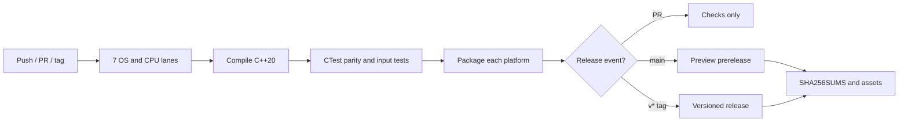

<div align="center">

# ⬟ PENTAGONAL XOR

### A tiny cross-platform C++20 parity engine with a mighty build matrix.

**Simply Well Executed** · **0BSD** · **No external runtime dependencies**

[](https://github.com/Simply-Well-Executed/pentagonal-xor-cpp20/actions/workflows/ship.yml)
[](https://github.com/Simply-Well-Executed/pentagonal-xor-cpp20/releases)
[](CMakeLists.txt)
[](LICENSE)
[](https://github.com/Simply-Well-Executed/pentagonal-xor-cpp20/actions)

**[⬇️ Browse downloadable releases](https://github.com/Simply-Well-Executed/pentagonal-xor-cpp20/releases)**  ·  **[⚙️ Watch live build matrix](https://github.com/Simply-Well-Executed/pentagonal-xor-cpp20/actions/workflows/ship.yml)**  ·  **[🛡️ Security policy](SECURITY.md)**

</div>

---

## 📡 COREAO RF: input → +9 dBi → EIRP output

New in PR #4: [`shared/coreao_gain.hpp`](shared/coreao_gain.hpp)
calculates an **idealized RF directional EIRP** from an unchanged
conducted-power input and a fixed **+9 dBi** gain:

`output_eirp_watts = input_watts × 7.943282347242816`.

The result retains input, gain, output, reconstructed input, a
normalized residual and an admissibility flag. Invalid/overflowing
inputs fail closed. Independent C++20 tests compare against
`pow(10,0.9)`, and installed-package tests exercise the public
header on every platform. It neither amplifies audio samples nor
claims additional total radiated watts, model-free word recognition or
a physical antenna measurement. [RF COREAO protocol](docs/COREAO_GAIN.md).

## 🔷 Stability-10D · PR #17 cross-repository operator port

**New in 0.2.0 (release candidate):** [`shared/stability10d.hpp`](shared/stability10d.hpp) pins **Stability** as the tenth numerical feature, derived from nine original acoustic measurements by three interlocked Pentagonal XOR rings and encoded as a six-byte hex witness. The header uses this project's original five-input parity kernel, not a second implementation.

The [`shared/coreo_stereo.hpp`](shared/coreo_stereo.hpp) operator extracts PR #17's reversible stereo-to-four-channel projection with read-only Z-fold verification. Both are C++20 header-only APIs installed with the existing CMake package. Independent tests check parity against 16-minterm references, exact hex golden vectors, original source preservation, domain guards, and forward/reverse/Z-fold inversion. Provenance: [source PR #17](https://github.com/pcheek1991/faster-whisper-4d-abandonedware-uniunlicensd/pull/17) at commit `432a228f`. See [the operator protocol](docs/STABILITY10D.md).

**Android:** the [experimental offline Java app](docs/ANDROID.md) is built by the release workflow as a clearly named **debug APK**. It requests no Internet or microphone permissions and reads user-selected raw stereo float32-le files. Android, Windows, macOS and Linux outputs are released with SHA-256 evidence, subject to successful CI.

**Critical scope:** this is **model-free audio feature analysis**, not an AI speech-to-text engine. No trained Whisper weights or tokenizer are present; the six-byte Stability signature cannot recognize spoken words. The separate original Whisper/CTranslate2 legacy code is *not* being silently presented as this library. A production-signed Android release requires an additional release-signing process.

## ∞ The mathematics

Five independent feature probabilities `h₁...h₅ ∈ [0,1]` produce a single
odd-parity probability by a direct closed-form calculation:

```text
P5 = (1 - (1-2*h1)(1-2*h2)(1-2*h3)(1-2*h4)(1-2*h5)) / 2
```

This is algebraically equivalent to the former fuzzy XOR recurrence:

```text
X0 = 0
Xk = X(k-1)*(1-hk) + (1-X(k-1))*hk
```

**One runtime path. No mode flags, default examples, runtime enumeration,
or hidden choices.** Supply five values to receive one score:

```powershell
.\\pentagonal_xor_cpp20.exe 0.80 0.70 0.90 0.60 0.95
```

```text
Pentagonal XOR: 51.72800000%
```

The single authoritative formula comes from the include-free C11 header
`shared/pentagonal_xor_std_free.h`, called directly from the C++20 CLI.
It performs constant work and uses no allocation or loops over minterms.

**Independent verification is kept in tests, not production execution.**
CTest compares the formula against both the original recursive fold and an
independent 32-state minterm reference: all 32 Boolean combinations and 4,096
deterministic fractional fixtures, plus invalid input checks. This change
removes runtime checks rather than claiming a measured speedup, and the
equivalent mathematical result is retained for valid inputs.

## 🧩 Include-free compatibility API

The [std-free C header](shared/pentagonal_xor_std_free.h) exposes the five-feature AND, OR, odd-parity XOR probability, partial, and fifth-root scores without standard headers, C++ standard-library dependencies, allocation, or platform APIs. It is compiled as strict C11 in the cross-platform shared-guard workflow.

On Windows, `SWE_PXOR_WINDOWS_LEGACY_TARGET` and `SWE_PXOR_USE_STDFREE_BACKEND` are selected from `_WIN32` and `_WIN32_WINNT`. This detects the **configured compiler target**, not the actual Windows version at runtime. The std-free header is portable and can be used on any supported platform.

PowerShell 7 build of the compatibility component:

```powershell
cmake -S .\\shared -B .\\shared\\build
cmake --build .\\shared\\build --config Release
ctest --test-dir .\\shared\\build -C Release --output-on-failure
```

---

## ⚡ The fast path is the only path

The prior `--fast` switch and the runtime 32-state validation mode have
been removed. Every valid invocation now uses the closed form. The program
requires exactly five finite inputs in `[0,1]`; extra arguments, missing
inputs, and out-of-range or nonfinite values fail instead of being guessed.

```powershell
cmake -S . -B build -DBUILD_TESTING=ON
cmake --build build --config Release
ctest --test-dir build -C Release --output-on-failure
```

## ♻️ DecaSigma: a separate reversible audit example

The new [DecaSigma reference](docs/DECASIGMA.md) and
[include-free C++20 header](shared/deca_sigma.hpp) demonstrate an exact
algebraic identity with a ten-step named trace:

```text
R(x)=1/x       S(x)=1-x        T(x)=R(S(R(x)))=x/(x-1)
R → S → R → T → R → S → R → T → R → R
```

For `x != 0,1`, the **exact mathematical** stages 4, 8 and 10 return to the
original x. The numeric implementation records every stage and checks those
return witnesses within tolerance. Inputs zero and one are blocked; floating
rounding and extreme values may additionally prevent reliable reconstruction.

This has practical educational utility for **reversible transformation
audits**, retaining an untouched original CORE and a reviewable sequence of
derived values. It does not compress, invert, authenticate, or secure
Pentagonal XOR output; no cryptographic property is claimed.

```powershell
cmake -S . -B build -DBUILD_TESTING=ON
cmake --build build --config Release
ctest --test-dir build -C Release --output-on-failure
```

---

## 🔎 Triℼ · Three inspection routes

[Triℼ inspection](docs/TRI_PI.md) adds three **read-only** C++20 checks
to the DecaSigma trace, checking **forward transitions**,
**reverse reconstruction**, and **Z-fold cross-stage witnesses**.
No special route names are assigned. All three must
agree for the derived trace audit to pass.

The header [`shared/tri_pi.hpp`](shared/tri_pi.hpp) is include-free and
has no dependency on the Pentagonal XOR hot path. Tests include altered
stages and correlated tampering. The audit checks algebraic consistency,
**not independent provenance or cryptographic security**. No CLI modes
or optional production branches have been added.

---

## 🌀 COREAO · one unified scalar

[COREAO](docs/COREAO.md) composes the three Triℼ inspection routes as
**forward → reverse → Z-fold**, without assigning special names to the
routes. The read-only [include-free implementation](shared/coreao.hpp)
derives the forward trace from CORE, fills the reverse path using the
forward result, and compares both against the unchanged record in Z-fold
order. The final scalar is the **maximum normalized disagreement**;
smaller means better consistency. Source-domain validity is retained as
a separate guard.

The DecaSigma operation sequence is defined **once** in
`shared/deca_sigma.hpp` and reused by both Triℼ and COREAO.
This is a bounded, constant-space audit, not encryption, authentication,
or a way to recover five Pentagonal XOR inputs from one score. The
production XOR calculation still has a single fast path with no extra
flags or runtime inspection cost.

---
## 🔐 Reproducible build and failure evidence

The [build-evidence policy and legal source references](docs/BUILD_EVIDENCE.md)
describe per-platform **SHA-256 manifests, CMake and compiler provenance,
optimized Release symbols (including Windows PDBs), partial build outputs,
CTest results, source snapshots, and logs**. GitHub Actions uploads these
evidence artifacts even when compilation or testing fails.

Windows release packages contain the generated executable PDB when available.
Unix builds retain compiler debug information in available build outputs.
Each `SHA256SUMS` hashes the files inside the CI evidence bundle; the
GitHub-generated artifact wrapper is created afterward and is not covered
by that internal manifest. The release pipeline separately hashes its
published archive files.

The original November 15, 2026 Windows MSVC C2131 failure is preserved
as a separate run in PR #3. **Earlier jobs cannot retroactively gain
PDBs or compiler hashes they never collected.** New manifests record
toolchain paths and hashes when found, but do not redistribute third-party
compiler executables under this project's 0BSD license.

---
## 🏁 Release pre-flight · no paused code

The [release audit and consumer contract](docs/RELEASE_PREFLIGHT.md)
documents the full source/workflow inspection. Both CI workflows now
run a PowerShell 7 pre-flight check for debugger traps, interactive
pauses, debug-only branches, disabled source blocks, and obsolete
terminology. Compile-time invariants and PDB symbols are preserved
because they do **not** stop execution.

**DecaSigma, Triℼ, and COREAO are now shipped as public header-only APIs**
in `include/swe/`, alongside the C11 parity header. The exported
`swe::swe_audit_headers` CMake target lets downstream C++20 consumers
compile the APIs. Each release platform must compile and execute a
fresh [installed-package consumer](tests/consumer/main.cpp) before
packaging. The regular XOR CLI still has one fast runtime path and no
additional mode flags.

---
## 🧰 Download matrix

Every successful build is packaged with the binary, documentation and 0BSD license. Release assets are named by OS and processor architecture.

| OS flavor | Architecture | Package |
|:--|:--|:--|
| 🐧 Ubuntu Linux | x86-64 | `pentagonal-xor-linux-x64.tar.gz` |
| 🐧 Ubuntu Linux | ARM64 | `pentagonal-xor-linux-arm64.tar.gz` |
| 🪟 Windows | x86-64 | `pentagonal-xor-windows-x64.zip` |
| 🪟 Windows | x86 / 32-bit | `pentagonal-xor-windows-x86.zip` |
| 🪟 Windows 11 (experimental) | ARM64 | `pentagonal-xor-windows-arm64.zip` |
| 🍎 macOS Intel | x86-64 | `pentagonal-xor-macos-x64.tar.gz` |
| 🍎 macOS Apple Silicon | ARM64 | `pentagonal-xor-macos-arm64.tar.gz` |

> Packages appear in Releases only after their corresponding GitHub Actions jobs succeed. Windows ARM64 is an experimental lane and can be unavailable.

## 🏁 Build it yourself

### PowerShell 7 (Windows, GCC)

```powershell
g++ -std=c++20 -O2 -Wall -Wextra -Wpedantic .\pentagonal_xor_cpp20.cpp -o .\pentagonal_xor_cpp20.exe
.\pentagonal_xor_cpp20.exe 0.80 0.70 0.90 0.60 0.95
```

### PowerShell 7 (CMake, cross-platform)

```powershell
cmake -S . -B build -DCMAKE_BUILD_TYPE=Release
cmake --build build --config Release --parallel
ctest --test-dir build -C Release --output-on-failure
```

### Bash (Linux / macOS)

```bash
cmake -S . -B build -DCMAKE_BUILD_TYPE=Release
cmake --build build --parallel
ctest --test-dir build --output-on-failure
./build/pentagonal_xor 0.80 0.70 0.90 0.60 0.95
```

## 🚀 The release conveyor belt



- **Pull requests** run compile, tests and artifact builds but cannot publish releases.
- **Commits to `main`** make a uniquely tagged **preview prerelease** when all non-experimental platforms pass.
- **Tags beginning with `v`** make versioned release assets.
- **`SHA256SUMS`** provides SHA-256 checksums for each downloadable archive.
- **Dependabot** checks GitHub Actions dependencies weekly. Issue forms and pull request templates help contributors.

## ⚖️ License and scientific limits

Copyright © 2026 **Paul Allen Cheek**. Licensed under [0BSD](LICENSE): reuse is permitted without mandatory attribution.

This is a mathematical parity engine, **not** a facial identity, age, genetic relationship, or provenance detector. The supplied feature values are chosen by the caller, and model output is not independent evidence of real-world relationships.

---

<div align="center"><sub>Made for reproducible experiments by Simply Well Executed. ⬟</sub></div>


## PENTAGONAL control family (experimental)

The native C++20 extension implements PENTAGONAL-OR, -AND, -NOP,
-COR, -VISTA and the six-stage FLOP return around the unchanged XOR.
The application sequence is **XOR → OR → AND → NOP → COR → FLOP ↺**
No extra XOR executes at the return point. The COR audit's separate
OR → XOR → AND entry-gate bypass is retained for compatibility.

Read [the full operator, provenance, MCU and optimization study](docs/PENTAGONAL_GATE_CASCADE.md).
Build and run the separate `pentagonal_control` executable for a
structured VISTA JSON report; the pre-existing command remains unchanged.
Missing independently authenticated witnesses are identified, never
silently presumed valid.


### GAMP 4-style Pentagonal operator verification

The [12-requirement URS/IQ/OQ/PQ validation plan](docs/PENTAGONAL_GAMP4_VALIDATION.md)
and `pentagonal_gamp4_validation_test` are now part of the native
C++20 test matrix. `ci/Invoke-PentagonalGamp4.ps1` records individual
PASS/FAIL assertions and source SHA-256 evidence. PQ and regulated-use
approval remain explicitly open; a green CI check is not GxP certification.
