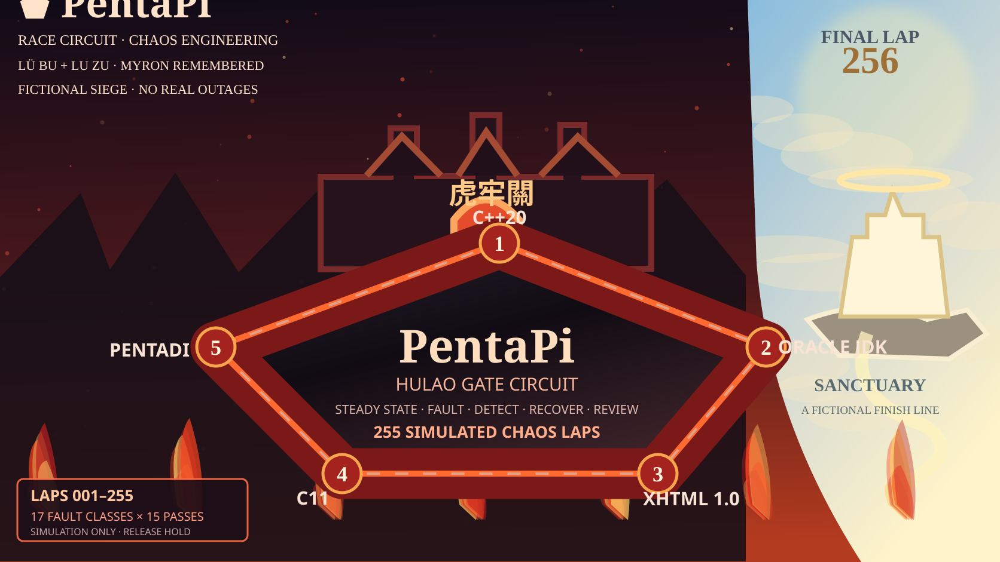

<!--
Copr.© 2026 by PAUL ALLEN CHEEK mail@pcheek.com C5824

Permission to use, copy, modify, and/or distribute this software for any purpose with or without fee is hereby granted.

THE SOFTWARE IS PROVIDED "AS IS" AND THE AUTHOR DISCLAIMS ALL WARRANTIES WITH REGARD TO THIS SOFTWARE INCLUDING ALL IMPLIED WARRANTIES OF MERCHANTABILITY AND FITNESS. IN NO EVENT SHALL THE AUTHOR BE LIABLE FOR ANY SPECIAL, DIRECT, INDIRECT, OR CONSEQUENTIAL DAMAGES OR ANY DAMAGES WHATSOEVER RESULTING FROM LOSS OF USE, DATA OR PROFITS, WHETHER IN AN ACTION OF CONTRACT, NEGLIGENCE OR OTHER TORTIOUS ACTION, ARISING OUT OF OR IN CONNECTION WITH THE USE OR PERFORMANCE OF THIS SOFTWARE.
-->

# ⬟ PENTAGONAL XOR

### Native C++20 parity | exact integers | compiler interoperability | continuous improvement

**Simply Well Executed** | **0BSD covered first-party code** | **Source-preserving research**

   

**Copr.© 2026 by PAUL ALLEN CHEEK mail@pcheek.com C5824**

[Live PR checks](https://github.com/Simply-Well-Executed/pentagonal-xor-cpp20/pull/95/checks) | [Core source](pentagonal_xor_cpp20.cpp) | [License](LICENSE) | [Security](SECURITY.md) | [Releases](https://github.com/Simply-Well-Executed/pentagonal-xor-cpp20/releases)

> **CURRENT roadmap for the draft PR #95 branch.** These additions are not automatically merged to the default branch. Every test result belongs to its exact commit. A failure remains evidence even after a corrected new run. **RELEASE=HOLD. Chosen, never assumed.**

## Attribution and documentation

[File attribution inventory](LICENSES/ATTRIBUTION.tsv) | [Contribution requirements](CONTRIBUTING.md) | [License registry](LICENSES/README.md)

## Accessibility and documentation

[Accessibility statement](ACCESSIBILITY.md) | [Documentation index](.wiki/Index.md) | [Contribution guide](CONTRIBUTING.md)

## 🧭 Project map

| Project area | Source or engineering record | Scope |
|:--|:--|:--|
| **Original CORE** | [Five-input C++20 parity source](pentagonal_xor_cpp20.cpp) and [CMake](CMakeLists.txt) | Authoritative original implementation, unchanged by experimental modes |
| **QuadDi** | [Four-lane workflow](.github/workflows/quaddi-ni-oracle-cpp20.yml) | C++20, Oracle JDK, XHTML Strict profile, C11 |
| **PentaDi** | [Dependent fifth-lane workflow](.github/workflows/pentadi-delphi7-asm.yml) | C11 assembly and branch record validation; Delphi 7 DCC32 remains HOLD |
| **PentaPi** | [Five-gate audit](pentadi/Invoke-PentaPiLapAudit.ps1) and [TCP255 method](docs/PENTAPI_TCP255_LAP_001.md) | Evidence grading, local TCP witness, human-reviewed next-lap proposals |
| **Hulao chaos** | [255-round exhibit](docs/PENTAPI_HULAO_GATE_255.md) and [fault-model source](pentadi/Invoke-HulaoChaos255.ps1) | 17 in-memory fault classes over 15 rounds; fictional Lap 256 |
| **BITFLYING** | [C11/C++20 shared ABI](shared/bitflying_c_abi_001.h) and [language test matrix](docs/BITFLYING_C11_CPP20_LANGUAGE_MATRIX_001.md) | Shared subset, not identical languages |
| **Exact Labrockets** | [1D to 100D to 1D ledger](docs/SOVIETA_SCIENCE_LABROCKETS_BIDI_100D_001.md) | Exact integer append and reverse, with separate symbolic operator metadata |
| **Micro widths** | [16-width and NOP register](docs/SOVIETA_SCIENCE_LABROCKETS_WIDTH_MATRIX_001.md) | Numeric 0/1/2/4/8/16 through 512-bit capacities; guarded NOP identity |
| **Rights and custody** | [LICENSE](LICENSE), [license registry](LICENSES/README.md), [rights and marks](docs/LICENSE_AND_MARKS.md) | Original code versus third-party rights and unknown terms |
| **Historical README** | [Preserved 624-line prior README](docs/README_SNAPSHOT_PRE_CURRENT_MAP_20261123.md) | Historical documentation retained, not current instructions by default |

## 🏁 Hulao Gate illustrated race circuit

**[Explore all 255 simulated chaos laps](docs/PENTAPI_HULAO_GATE_255.md)** | **[Open the scriptless 256-lap XHTML source](docs/PentaPi_Hulao_256.xhtml)** | **[View the SVG poster](docs/pentapi_hulao_gate.svg)**

🔥 What happens during the 255 modeled Hulao laps?

The [bounded chaos engine](pentadi/Invoke-HulaoChaos255.ps1) checks known steady state, one deliberate in-memory fault, detection, and exact recovery for every simulated lap. Its 17 fault categories include packet drop, latency, duplication, reordering, payload/frame corruption, stale provenance, checksum faults, nbit overflow, GLINTING loss, conflicting ownership, branch oscillation, out-of-range rel8, malformed TSV, and rejected remote endpoint data.

The Hulao Gate, Lü Bu, Lu Zu, Myron remembrance, fire and sanctuary are fictional storytelling. **Nobody and no production system is attacked.** The artistic Lap 256 is not a software certification, an afterlife claim, or permission to release.

GitHub Markdown displays SVG artwork and expandable sections but does not execute arbitrary interactive webpages. Save the adjacent XHTML and SVG files and open XHTML locally in a browser for clickable round navigation.

## 💎 QuadDi → PentaDi → PentaPi

The order is enforced by the [QuadDi workflow](.github/workflows/quaddi-ni-oracle-cpp20.yml). Only a successful QuadDi job permits its [PentaDi dependent workflow](.github/workflows/pentadi-delphi7-asm.yml), which then performs the PentaPi and controlled chaos-model checks.

| Lane | Required positive witness | Explicit boundary |
|---|---|---|
| **1 | C++20** | MSVC optimized native mathematical and guard checks | No unmeasured performance or repository-wide STL-free claim |
| **2 | Oracle Java** | Pinned vendor, JDK archive digest and independent parity | Oracle vendor licensing is not covered by the project's 0BSD grant |
| **3 | XHTML 1.0 Strict** | Strict DOCTYPE, XML namespace and bounded XML/profile checks | **Full external W3C DTD validation is not proven** |
| **4 | C11** | Same MSVC toolchain, different language mode; positive/negative tests | C11 and C++20 are not identical programming languages |
| **5 | PentaDi** | C11 compiler-generated raw assembly listing, guarded branch records and MASM reference | **Proprietary Delphi 7 compiler has not been independently executed** |

The fifth lane includes the [C11 source records](pentadi/PentaDiC11BranchRecords.c), [one canonical nine-record ledger](pentadi/PentaDiC11BranchRecords.reference.tsv), [Pascal branch-pin module](pentadi/BranchPinToTsht.pas), [pipe runner](pentadi/Delphi007PinPipe.dpr), and [verified source-custody script](pentadi/Invoke-PentaDiQualification.ps1). MSVC produces the assembly listing, **not** Delphi 7. The [hand-authored reference ASM](pentadi/PentaDiRel8_reference.asm) is independently identified.

The original user-supplied [keep.pass](pentadi/keep.pass) is preserved separately from [BuildSpeedProfiler.pas](pentadi/BuildSpeedProfiler.pas). Build profiling does not function as a compiler. The proposed speed-mode range, overflow, and I/O disabling is **not** allowed to bypass branch-safety qualification.

**PentaPi** reads the five-gate evidence, retains source hashes and proposes the next lap for review. Its [loopback TCP test](pentadi/Invoke-PentaPiTcp255.ps1) sets **initial IPv4 TTL 255** before connecting to 127.0.0.1, exchanges a framed nine-byte payload and checks the echo. TTL is a hop limit, **not a 255-year timer**, nor proof of on-wire TTL at routers. The [255-round simulation](pentadi/Invoke-HulaoChaos255.ps1) modifies only disposable modeled values, not real packets or services.

**Current result must be checked on the exact PR head:** [PR #95 live CI](https://github.com/Simply-Well-Executed/pentagonal-xor-cpp20/pull/95/checks). An earlier green subgate does not override a later failure.

## 🔢 Mathematical and native research

The original [five-input parity engine](pentagonal_xor_cpp20.cpp), [Pentagonal Suite](docs/PENTAGONAL_SUITE.md), [PENTAGONAL control experiments](docs/PENTAGONAL_GATE_CASCADE.md), [VISTA 9×9](docs/VISTA_9X9.md), [Stability10D](docs/STABILITY10D.md), [COREAO +9 dBi example](docs/COREAO_GAIN.md), and [TOOLONG/DecaSigma](docs/TOOLONG.md) are separately sourced.

The [exact 100D Labrockets ledger](docs/SOVIETA_SCIENCE_LABROCKETS_BIDI_100D_001.md) preserves the full decimal series, appending nine-digit blocks on the **right** and validating the reverse division. The rocket is LEFT; the nine-single-digit NASCAR car is RIGHT. Significant bit width, decimal precision, and register capacity are distinct properties.

The [expanded 16-width matrix](docs/SOVIETA_SCIENCE_LABROCKETS_WIDTH_MATRIX_001.md) covers NOBIT (numeric zero-capacity), 1, 2, 4, 8, 16 and the historical 32 through 512-bit capacities. **NOP is an operation, not a width.** No real hardware register is claimed to store unlimited software memory. The [exploratory operator lexicon](docs/EXPLORATORY_OPERAND_MODES.md) preserves source spellings without mistaking experimental symbols for C++ syntax.

## 🔧 Local native verification

Use installed and source-verified native toolchains. Review the [PowerShell verification entrypoint](ci/Invoke-NativeCore.ps1), [platform matrix](docs/NATIVE_PLATFORM_MATRIX.md), [build-evidence policy](docs/BUILD_EVIDENCE.md) and [release preflight](docs/RELEASE_PREFLIGHT.md) before selecting a build. The CMake/CTest pipeline has platform-dependent targets and must be validated for each environment; a successful Windows job is not certification of all operating systems.

Compiler optimization for qualifying native code uses MSVC /O2 or approved-toolchain -O2, without claiming an unmeasured speedup. Experimental YAML jobs do **not** automatically publish or merge releases.

## ⚖️ Copyright notice, 0BSD and legal boundaries

**Copr.© 2026 by PAUL ALLEN CHEEK mail@pcheek.com C5824**

The notice above is the requested first-party text already present in the root [LICENSE](LICENSE). **C5824 is preserved as supplied**, without representing it as a verified court case, registration, or exclusive judicial finding. Under U.S. copyright law, eligible original authored work generally gains protection once fixed in a tangible medium of expression; a lawsuit may adjudicate rights but is not the prerequisite for creating them. The [U.S. Copyright Office](https://www.copyright.gov/what-is-copyright/) and [17 U.S.C. section 101](https://uscode.house.gov/us/usc/119-118/t17/s101/) explain fixation. Losing a court case does not by itself automatically transfer an otherwise owned copyright.

The repository's **0BSD license remains a separate operative permission grant** for first-party works covered by that license, not ownership of all dependencies. Third-party files and product names require their own rights review. Read the [rights and marks note](docs/LICENSE_AND_MARKS.md), [local license ledger](LICENSES/README.md), [source-custody protocol](docs/LOCALITY_FIRST_SOURCE_CUSTODY.md), and [current dependency restrictions](docs/GNU_POSIX_ZERO_APPROVAL_POLICY.md). Oracle and Borland/Delphi products retain vendor-specific terms; no unverified binary is redistributed under 0BSD. Unknown/mixed terms remain **HOLD / REVIEW**.

## 🗂️ Preserve the archive without promoting it

The [pre-refactor 624-line README snapshot](docs/README_SNAPSHOT_PRE_CURRENT_MAP_20261123.md) retains earlier platform experiments, PR histories, Docker/Android, native build instructions, mathematical research, and dated claims. Nothing in that snapshot is deleted, but **older guidance is not automatically current policy**. Additional research can be found in [document review](docs/DOCUMENT_REVIEW_REGISTER.md), [NINZA/PING](docs/NINZA_PING_UNFORGE_UNTWIRL.md), [DOLPHIN](docs/DOLPHIN_SUBJECT_SEARCH.md), and [MINZA 3D](docs/MINZA_CENTRIX_NATIVE_DOM_V12.md).

---

**Original source → route → witness → ledger → review.**

**Draft PR #95 | RELEASE=HOLD | Chosen, never assumed.** 🏁

## AIRMAN exploration laboratory

[3D-THAILONGA / AERIS / NULL0 HEX99 / D64-D97-D20 TRIFORCE](docs/AIRMAN.md) includes source-preserving geometry, signed Euler jig, orbital schematics, configuration and constellation witnesses, and the separate native `airman_viewer` target. RELEASE=HOLD pending native and accessibility qualification.
