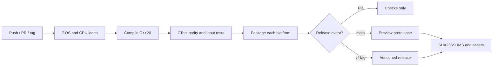

<div align="center">

# ⬟ PENTAGONAL XOR

### Native C++20 parity engine with canonical UTF-8 source.

**Simply Well Executed** · **0BSD** · **Native runtime imports under audit**

**Native verification:** [PowerShell + MSVC + CTest](ci/Invoke-NativeCore.ps1) or [explicit GitHub cloud GAMP4 workflow](.github/workflows/github-cloud-docker-gamp4.yml) (no user-local compute for cloud runs)
[](https://github.com/Simply-Well-Executed/pentagonal-xor-cpp20/releases)
[](CMakeLists.txt)
[](LICENSE)
[](docs/NATIVE_PLATFORM_MATRIX.md)

**[📦 GitHub Packages: Android source-study image](https://github.com/orgs/Simply-Well-Executed/packages/container/package/android-source-study-v1)** · **[⬇️ Browse downloadable releases](https://github.com/Simply-Well-Executed/pentagonal-xor-cpp20/releases)**  ·  **[Run local native C++20 verification](ci/Invoke-NativeCore.ps1)**  ·  **[🛡️ Security policy](SECURITY.md)**

</div>

---

## Container images: Docker Hub and GitHub Packages

**Historical Docker Hub image, verified and published.** [Docker Hub source study](https://hub.docker.com/r/paulcheek/android-source-study-v1) is available as `paulcheek/android-source-study-v1:latest`; [GitHub Actions run #44746338664](https://github.com/Simply-Well-Executed/pentagonal-xor-cpp20/actions/runs/44746338664) performed the real authenticated same-digest push and verified the remote manifest:

```text
sha256:5791dcef8beb3704f58346e79af0ec5313f0599c2320b204939cf29aeda6ad30
```

**GitHub Container Registry mirror, identical bytes.** [GitHub Packages: android-source-study-v1](https://github.com/orgs/Simply-Well-Executed/packages/container/package/android-source-study-v1) contains `ghcr.io/simply-well-executed/android-source-study-v1:sha-07eb2a4561f0`. [GitHub cloud execution #44752703980](https://github.com/Simply-Well-Executed/pentagonal-xor-cpp20/actions/runs/44752703980) confirmed the copied GHCR manifest digest equals the Docker Hub digest above. **GitHub initially reports this package as private** even though the source repository is public; repository admins must select public visibility in its package settings before anonymous visitors can browse or pull it. The mirror is historical and is **not asserted Python-free**.

**Python-free Android/Linux build requirement.** A separate [source/runtime no-Python protocol](docs/ANDROID_LINUX_NO_PYTHON.md) enforces removal of Python interpreters and package-manager-owned Python components from newly built source-study images, rejects Python dependency entrypoints, and requires source-matched GitHub-cloud C++20 `-O2` / full CTest / Java 17 validation. Successful images receive a **separate candidate** tag; the historical immutable image is never silently overwritten. Android device OQ, full 13-profile GAMP4 release, and independent QA remain separate gates.

**Verified GitHub-hosted Python-free Android/Linux candidate.** [Run #44753219140](https://github.com/Simply-Well-Executed/pentagonal-xor-cpp20/actions/runs/44753219140) built the modified SDK-free source image from Git commit `ed28e0544042ad700afb6e611796912294f172db`, passed **45/45 native C++20 CTests** with explicit `-O2`, passed **26,654 independent Java 17 checks**, and confirmed absent Python executables and distribution packages during build, inside the offline test container, and after GHCR digest pull. Its independently named GHCR tag is:

```text
ghcr.io/simply-well-executed/android-source-study-v1:python-free-candidate-ed28e0544042
sha256:cf8ea2216382fd030d36caeb8092d28506c1bd74128cfb0f8beedc303aa24b62
```

**This is a candidate, not a new approved production release.** The original historic Docker Hub digest remains unchanged; Android device acceptance, independent QA, and the remaining 12 GAMP4 platform profiles are not implied. GitHub package visibility is separately private until an authorized package administrator changes it.
Repository source: [`docker/android-source-study-v1.Dockerfile`](docker/android-source-study-v1.Dockerfile), [`ci/Mirror-AndroidSourceStudy-GHCR.sh`](ci/Mirror-AndroidSourceStudy-GHCR.sh), and [GitHub cloud GHCR workflow](.github/workflows/cloud-ghcr-android-no-python.yml).

## GAMP4-gated local Docker release staging (candidate)

An explicit, operator-requested [GAMP4 Docker release protocol](docs/GAMP4_DOCKER_RELEASE.md) now provides a **local-only, SHA256-digest-pinned Docker Compose** path for full Linux CMake/CTest and all twelve GAMP4-style URS checks, plus offline Android NDK archive builds dependent on the validated source SHA. Native **macOS Intel/Apple Silicon** and **Windows Win32/x64/ARM64** validation scripts produce separate platform-specific GAMP4/CTest evidence. Docker cannot provide a genuine macOS runtime, and Windows container images require matching Windows infrastructure.

The [13-profile release YAML](ci/gamp4-docker-release.yml) and [offline Docker Compose](docker/compose.release.yml) require cached toolchain images, local Docker daemon, disabled container networking, non-root execution, read-only Git-archived committed source without .git or untracked files and no automatic image/SDK downloads. The [release assembler](ci/Assemble-Gamp4-Release.sh) refuses incomplete source-matched evidence or failed package checksums; it stages bundles and release notes with status **STAGED_NOT_PUBLISHED**. The optional [OCI payload Dockerfile](docker/ReleasePayload.Dockerfile) transports multi-OS files but is **not a runnable macOS/Windows/Android container**.

**One scoped GitHub-hosted Linux amd64 GAMP4-style validation** passed 44/44 CTest and 12/12 URS on commit `3b4fef5f49d1d90029b88184a91a84d4598f4d48` ([run #44704209472](https://github.com/Simply-Well-Executed/pentagonal-xor-cpp20/actions/runs/44704209472)). Other 12 release profiles, QA and production qualification are not implied. The user explicitly authorized GitHub-hosted compute; self-hosted and user-local runners remain excluded from the cloud workflows. Full repository STD-free certification remains unclaimed.

## Exploratory calculus operator lexicon: three independent modes

The [experimental operand protocol](docs/EXPLORATORY_OPERAND_MODES.md) preserves exact operators such as `=`, `;=`, `[=`, `]=`, the ten original COREAO PlusStar spellings and the user's additional gain/dispersion/stability modes. Every one of the **14 underlying operand identities** has **three conceptual mode slots**, giving **42** slots. The separate STD-free C++20 [lexicon](shared/quantum_operand_lexicon.hpp) stores 24 exact spelling records, including standalone `+`, directly listed `+=`, earlier distinct `+;`, `+'`, `+-`, and `+p/-p/=p`, `+P/-P/=P`, shift-up `+/` and shift-down `+\`.

The proposed counterparts `-/`, `=/`, `-\`, and `=\` have explicitly **inferred notation**; their three semantic modes are user-specified, but the exact written forms are not yet independently confirmed. Association of shift up with inverse-square law and shift down with the root-of-square theorem is **descriptive**, not a complete numerical function. Nothing here claims a new quantum-physics law or performs an unreviewed calculation.

The directly listed `+=` is categorized under the gain-prefix Equality *syntax slot*, without inventing assignment, comparison, or arithmetic semantics. Standalone `+` retains its own unassigned-mode literal identity, separate from `++`. The older `+;`, `+'`, `+-` meanings are preserved as historical records.

The [exact-token test](tests/quantum_operand_lexicon_test.cpp) is registered as `quantum_operand_exact_symbol_registry`, and the optional STD-free core archive statically imports this lexicon. The original parity engine and release/GAMP4 process are untouched.
## Offline STD-free core and native multi-OS matrix

[Native platform matrix](ci/native-platform-matrix.yml) now declares locally buildable C++20 static-archive profiles for **macOS arm64 / x86_64 / universal**, **Windows x86 / x64 (AMD64) / ARM64**, **Linux x86 / x86_64 / ARM64**, and **Android arm64-v8a / armeabi-v7a / x86 / x86_64**. The macOS 32-bit Intel profile is explicitly unsupported on modern macOS, not silently marked green. See [OS/ABI setup and operator commands](docs/NATIVE_PLATFORM_MATRIX.md).

The opt-in `-DSWE_STD_FREE_CORE_ONLY=ON` CMake path compiles the [STD-free portable core probe](tests/std_free_portable_probe.cpp) into a static archive and installs ten native STD-free public headers, including the existing DecaSigma/TriPi/COREAO/gain/stereo/Stability10D math contracts. It skips unrelated legacy projects **only for this explicitly scoped build**; the normal full build remains available. The local [POSIX builder](ci/Build-PlatformMatrix.sh) and [Windows PowerShell builder](ci/Build-PlatformMatrix.ps1) perform no network fetch, package installation, hosted runner execution or container launch. Their local YAML reports say `ARCHIVE_BUILT_NOT_RUNTIME_TESTED`, not a claimed application pass.

The independent [STD-free parity CLI](src/parity_std_free_main.cpp) reuses the original five-feature probability function and has six comparison CTests. It is not yet promoted over the [original parity CLI](pentagonal_xor_cpp20.cpp); its strict ASCII decimal parser does not claim full `std::stod` grammar/locale equivalence. The existing legacy headers, tools and tests still contain standard-library dependencies, so **the entire repository is not yet STD-free**.

Generate the current complete source inventory using `sh ci/Export-StdFreeInventory.sh > .iron-std-free-inventory.yml`. The POSIX T-CROSS default also writes this inventory and a Git-derived `+/-DIFF` YAML before enforcing strict gates. No source deletion or replacement of mathematical definitions is performed to manufacture a green result.

## PENTAGONAL SUITE: nine native C++20 operations

The additional [Pentagonal Suite header](include/pentagonal_suite.hpp) supplies **XOR, OR, AND, NAND, NOP, NIL, NAN, COR and VISTA** as an independent operation family. It reuses the original pentagonal numeric source and bytewise XOR implementation rather than duplicating either. The suite includes [an independent Windows/Linux/macOS CLI](src/suite_main.cpp) and [compile-time plus runtime regression cases](tests/pentagonal_suite_test.cpp); it does **not** replace the established five-feature parity CLI or the original throughput benchmark.

These three new suite C++ files use **zero C/C++ standard-library headers, zero `std::` references and zero code comments**. See [operation mapping and overflow/NAN contracts](docs/PENTAGONAL_SUITE.md). A new local T-CROSS gate checks comment-free source, and the existing STD-free source and binary-import gates now include the suite. Exact-seeded transforms and 256-byte-periodic LUT transforms remain distinct; NIL zero-fill is not a guarantee of secure memory erasure; NAN boxing stores integer bit patterns rather than floating-point secrets.

The newly added suite target and its tests have not been independently built or executed in the actual PR checkout. The strict whole-repository STD-free and residual historical-source gates remain blocking. The PR remains draft and unmerged.

## STD-free throughput engine (exploratory PR #19)

The optional [byte-stream XOR header](include/pentagonal_xor.hpp), [fixed-buffer and borrowed-view header](include/pxor_memory.hpp), [native benchmark CLI](src/main.cpp), and [throughput regression](tests/pentagonal_xor_throughput_test.cpp) have been refactored to **zero C/C++ standard-library headers and zero `std::` calls in those four sources**. They use C++20 language features and explicit Win32/POSIX APIs. `fast_xor_buffer` now uses `constexpr` little-endian byte packing and unpacking instead of `std::memcpy`; scoped decrypted literals use runtime volatile cleanup without `std::is_constant_evaluated`. Native OS page allocation replaces C++ `new` for optional buffers over the default 16 MiB.

The original five-feature [parity CLI](pentagonal_xor_cpp20.cpp), other historical libraries and existing tests **are not yet STD-free**. A whole-repository T-CROSS gate is present and must remain blocking until those files are independently migrated and regression-tested. Runtime linkage to libc/UCRT or standard C++ libraries has **not been inspected on a compiled PR binary**. Source-level absence of `std::` does not imply freestanding operation, zero imports, or absence of system calls. The new CLI's native I/O backend now targets Windows, Linux and supported macOS; Android uses the cross-compiled archive-only core without pretending to run a desktop CLI.

See [STD-free native T-CROSS audit](docs/STD_FREE_NATIVE_T_CROSS.md) and [POSIX/YAML gates](Taskfile.yml). No new full-build or linker result is asserted by this source change. The periodic 256-byte stream remains distinct from the exact seeded sequence.

## Local native verification (Draft PR #19)

**No GitHub Actions runner, VM image or self-hosted runner.** The PR branch removes the remaining `.github/workflows/native-core.yml` and runs verification only when the maintainer invokes [`ci/Invoke-NativeCore.ps1`](ci/Invoke-NativeCore.ps1) on a locally controlled Windows machine. It uses installed PowerShell, Git (local inspection only), MSVC, CMake and CTest. It does not install dependencies, fetch source, query a REST API, invoke Node, or call Docker. Historical workflow files remain in Git history; `main` is unchanged until the PR is merged.

**Current operator command (review the official latest-stable release first):**

```powershell
Set-StrictMode -Version 2.0
pwsh -NoLogo -NoProfile -File .\ci\Invoke-NativeCore.ps1 -LatestStableVersion 7.7.0 -ReleaseEvidenceUri 'https://github.com/PowerShell/PowerShell/releases/tag/v7.7.0'
```

The `-LatestStableVersion` argument is **not a repository pin**. The operator must independently check the official [PowerShell releases](https://github.com/PowerShell/PowerShell/releases/latest) and supply the latest stable version at the time of execution, updating the command when newer versions are released. The script requires an exact installed-version match **before** verifying any source or running a build. Its offline evidence record states explicitly that the provided release URL is operator-asserted rather than verified over a network. Native hosting eliminates image drift, but the local machine, toolchain provenance and actual network isolation still require review.

**Source integrity:** The local entrypoint runs the existing [Magic Comb](ci/Invoke-MagicComb.ps1) in SelfTest and Verify modes (strict UTF-8, Unicode NFKC, remove U+200B..U+200D and U+FEFF, nesting depth 9), then requires ISO C++20 (`CXX_STANDARD 20`, `CXX_STANDARD_REQUIRED ON`, `CXX_EXTENSIONS OFF`) with MSVC `/O2`, builds, and invokes CTest. It writes `.iron-native-evidence.json` locally. It does **not** download or execute an automated installer.

**POSIX T-CROSS +/−DIFF gate runner:** [Taskfile.yml](Taskfile.yml) is the declarative, version-3 YAML manifest; [ci/t-cross-posix.sh](ci/t-cross-posix.sh) is the actual executable implementation. The Task CLI is optional and never installed automatically. Run `sh ci/t-cross-posix.sh` in a locally controlled, already-checked-out source tree to generate a fresh `.iron-t-cross-diff.yml` from Git and attempt the nine ordered gates. To export only the derived audit YAML: `sh ci/t-cross-posix.sh emit-diff-yaml > .iron-t-cross-diff.yml`. The generated file is local and ignored by Git; exact baseline/current SHAs and counts derive from Git, never from display prose.

**Zero-CALL scope:** [tests/zero_call_core_probe.cpp](tests/zero_call_core_probe.cpp) compiles a separate object using the *canonical shared five-input parity function* under the existing /O2 or -O2 policy. The POSIX disassembly gate requires no CALL instructions in that **isolated mathematical core**. The CLI still performs input parsing, validation, and output; those are not covertly certified as call-free. The historical fifth-root helper has been made non-recursive. Current `java/`, `docker/`, and `android/` directories remain tracked, so a strict whole-tree residual-surface gate will fail until a separately audited retirement. The native tests and nine-gate bundle have not yet been executed under the new ISO mode.

**Historical comparison evidence, not a new local test:** [Hosted run 44661958832](https://github.com/Simply-Well-Executed/pentagonal-xor-cpp20/actions/runs/44661958832) passed 164 tracked-source checks and 34/34 CTests but failed the PowerShell 7.6.9 versus 7.7.0 version gate. No completed run of the new local entrypoint has yet been independently observed. See [IRON / T-CROSS audit](docs/IRON_T_CROSS_REVIEW.md). Do not claim native IRON certification from historical hosted checks.

**Source custody:** Historical Java/Android, Docker, PGO, cross-platform, release and Node-backed workflow definitions remain in earlier Git commits. Manually callable historical scripts and source directories also remain tracked pending separate review, but are not part of the local native entrypoint.

## ⬟ toolong: exact C++20 arbitrary-precision integers (draft PR #17)

The optional [`swe::toolong`](shared/toolong.hpp) class provides exact signed integers with dynamically sized decimal digits, including addition, subtraction, multiplication, division, modulo, powers, factorials, GCD, and explicit-width bitwise views. [Exact reduced fractions](shared/toolong_ratio.hpp) and a separate [synthetic photon-count gain/dispersion example](shared/toolong_photon_model.hpp) use integer arithmetic rather than floating-point approximations. See [the operator and evidence contract](docs/TOOLONG.md).

The π-derived [16-significant-digit display policy](shared/pi_precision.hpp) applies to floating-point presentations, **not** to exact integer source records or numeric results. The additions were integrated through [merged PR #17](https://github.com/Simply-Well-Executed/pentagonal-xor-cpp20/pull/17).

## 📡 COREAO RF: input → +9 dBi → EIRP output

New in PR #4: [`shared/coreao_gain.hpp`](shared/coreao_gain.hpp)
calculates an **idealized RF directional EIRP** from an unchanged
conducted-power input and a fixed **+9 dBi** gain:

`output_eirp_watts = input_watts × 7.943282347242816`.

The result retains input, gain, output, reconstructed input, a
normalized residual and an admissibility flag. Invalid/overflowing
inputs fail closed. Independent C++20 tests compare against
`pow(10,0.9)`, and installed-package tests exercise the public
header on every platform. It neither amplifies audio samples nor
claims additional total radiated watts, model-free word recognition or
a physical antenna measurement. [RF COREAO protocol](docs/COREAO_GAIN.md).

## 🔷 Stability-10D · PR #17 cross-repository operator port

**New in 0.2.0 (release candidate):** [`shared/stability10d.hpp`](shared/stability10d.hpp) pins **Stability** as the tenth numerical feature, derived from nine original acoustic measurements by three interlocked Pentagonal XOR rings and encoded as a six-byte hex witness. The header uses this project's original five-input parity kernel, not a second implementation.

The [`shared/coreo_stereo.hpp`](shared/coreo_stereo.hpp) operator extracts PR #17's reversible stereo-to-four-channel projection with read-only Z-fold verification. Both are C++20 header-only APIs installed with the existing CMake package. Independent tests check parity against 16-minterm references, exact hex golden vectors, original source preservation, domain guards, and forward/reverse/Z-fold inversion. Provenance: [source PR #17](https://github.com/pcheek1991/faster-whisper-4d-abandonedware-uniunlicensd/pull/17) at commit `432a228f`. See [the operator protocol](docs/STABILITY10D.md).

**Historical Android research:** the [experimental offline Java app](docs/ANDROID.md) is not built or released by the local native verifier. Earlier experiment records and sources remain for provenance; no new APK or multi-platform release is promised.

**Critical scope:** this is **model-free audio feature analysis**, not an AI speech-to-text engine. No trained Whisper weights or tokenizer are present; the six-byte Stability signature cannot recognize spoken words. The separate original Whisper/CTranslate2 legacy code is *not* being silently presented as this library. A production-signed Android release requires an additional release-signing process.

## ∞ The mathematics

Five independent feature probabilities `h1...h5 ∈ [0,1]` produce a single
odd-parity probability by a direct closed-form calculation:

```text
P5 = (1 - (1-2*h1)(1-2*h2)(1-2*h3)(1-2*h4)(1-2*h5)) / 2
```

This is algebraically equivalent to the former fuzzy XOR recurrence:

```text
X0 = 0
Xk = X(k-1)*(1-hk) + (1-X(k-1))*hk
```

**One runtime path. No mode flags, default examples, runtime enumeration,
or hidden choices.** Supply five values to receive one score:

```powershell
.\\pentagonal_xor_cpp20.exe 0.80 0.70 0.90 0.60 0.95
```

```text
Pentagonal XOR: 51.72800000%
```

The single authoritative formula comes from the include-free C11 header
`shared/pentagonal_xor_std_free.h`, called directly from the C++20 CLI.
It performs constant work and uses no allocation or loops over minterms.

**Independent verification is kept in tests, not production execution.**
CTest compares the formula against both the original recursive fold and an
independent 32-state minterm reference: all 32 Boolean combinations and 4,096
deterministic fractional fixtures, plus invalid input checks. This change
removes runtime checks rather than claiming a measured speedup, and the
equivalent mathematical result is retained for valid inputs.

## 🧩 Include-free compatibility API

The [std-free C header](shared/pentagonal_xor_std_free.h) exposes the five-feature AND, OR, odd-parity XOR probability, partial, and fifth-root scores without standard headers, C++ standard-library dependencies, allocation, or platform APIs. It was previously verified as C11 in the now-retired cross-platform guard. The local native verifier builds and tests the C++20 project; the C11 compatibility API remains a separately identified historical interface.

On Windows, `SWE_PXOR_WINDOWS_LEGACY_TARGET` and `SWE_PXOR_USE_STDFREE_BACKEND` are selected from `_WIN32` and `_WIN32_WINNT`. This detects the **configured compiler target**, not the actual Windows version at runtime. The std-free header is portable and can be used on any supported platform.

PowerShell Core (latest stable version), with StrictMode 2.0, historical compatibility example:

```powershell
Set-StrictMode -Version 2.0
cmake -S .\\shared -B .\\shared\\build
cmake --build .\\shared\\build --config Release
ctest --test-dir .\\shared\\build -C Release --output-on-failure
```

---

## ⚡ The fast path is the only path

The prior `--fast` switch and the runtime 32-state validation mode have
been removed. Every valid invocation now uses the closed form. The program
requires exactly five finite inputs in `[0,1]`; extra arguments, missing
inputs, and out-of-range or nonfinite values fail instead of being guessed.

```powershell
cmake -S . -B build -DBUILD_TESTING=ON
cmake --build build --config Release
ctest --test-dir build -C Release --output-on-failure
```

## ♻️ DecaSigma: a separate reversible audit example

The new [DecaSigma reference](docs/DECASIGMA.md) and
[include-free C++20 header](shared/deca_sigma.hpp) demonstrate an exact
algebraic identity with a ten-step named trace:

```text
R(x)=1/x       S(x)=1-x        T(x)=R(S(R(x)))=x/(x-1)
R → S → R → T → R → S → R → T → R → R
```

For `x != 0,1`, the **exact mathematical** stages 4, 8 and 10 return to the
original x. The numeric implementation records every stage and checks those
return witnesses within tolerance. Inputs zero and one are blocked; floating
rounding and extreme values may additionally prevent reliable reconstruction.

This has practical educational utility for **reversible transformation
audits**, retaining an untouched original CORE and a reviewable sequence of
derived values. It does not compress, invert, authenticate, or secure
Pentagonal XOR output; no cryptographic property is claimed.

```powershell
cmake -S . -B build -DBUILD_TESTING=ON
cmake --build build --config Release
ctest --test-dir build -C Release --output-on-failure
```

---

## 🔎 Triπ · Three inspection routes

[Triπ inspection](docs/TRI_PI.md) adds three **read-only** C++20 checks
to the DecaSigma trace, checking **forward transitions**,
**reverse reconstruction**, and **Z-fold cross-stage witnesses**.
No special route names are assigned. All three must
agree for the derived trace audit to pass.

The header [`shared/tri_pi.hpp`](shared/tri_pi.hpp) is include-free and
has no dependency on the Pentagonal XOR hot path. Tests include altered
stages and correlated tampering. The audit checks algebraic consistency,
**not independent provenance or cryptographic security**. No CLI modes
or optional production branches have been added.

---

## 🌀 COREAO · one unified scalar

[COREAO](docs/COREAO.md) composes the three Triπ inspection routes as
**forward → reverse → Z-fold**, without assigning special names to the
routes. The read-only [include-free implementation](shared/coreao.hpp)
derives the forward trace from CORE, fills the reverse path using the
forward result, and compares both against the unchanged record in Z-fold
order. The final scalar is the **maximum normalized disagreement**;
smaller means better consistency. Source-domain validity is retained as
a separate guard.

The DecaSigma operation sequence is defined **once** in
`shared/deca_sigma.hpp` and reused by both Triπ and COREAO.
This is a bounded, constant-space audit, not encryption, authentication,
or a way to recover five Pentagonal XOR inputs from one score. The
production XOR calculation still has a single fast path with no extra
flags or runtime inspection cost.

---
## 🔐 Reproducible build and failure evidence

The [build-evidence policy and legal source references](docs/BUILD_EVIDENCE.md)
describe per-platform **SHA-256 manifests, CMake and compiler provenance,
optimized Release symbols (including Windows PDBs), partial build outputs,
CTest results, source snapshots, and logs**. GitHub Actions uploads these
evidence artifacts even when compilation or testing fails.

Windows release packages contain the generated executable PDB when available.
Unix builds retain compiler debug information in available build outputs.
Each `SHA256SUMS` hashes the files inside the CI evidence bundle; the
GitHub-generated artifact wrapper is created afterward and is not covered
by that internal manifest. The release pipeline separately hashes its
published archive files.

The original November 15, 2026 Windows MSVC C2131 failure is preserved
as a separate run in PR #3. **Earlier jobs cannot retroactively gain
PDBs or compiler hashes they never collected.** New manifests record
toolchain paths and hashes when found, but do not redistribute third-party
compiler executables under this project's 0BSD license.

---
## 🏁 Release pre-flight · no paused code

The [release audit and consumer contract](docs/RELEASE_PREFLIGHT.md)
documents the historical source/workflow inspection. Former CI workflows
ran a PowerShell 7 pre-flight check for debugger traps, interactive
pauses, debug-only branches, disabled source blocks, and obsolete
terminology. Compile-time invariants and PDB symbols are preserved
because they do **not** stop execution.

**DecaSigma, Triπ, and COREAO are now shipped as public header-only APIs**
in `include/swe/`, alongside the C11 parity header. The exported
`swe::swe_audit_headers` CMake target lets downstream C++20 consumers
compile the APIs. Each release platform must compile and execute a
fresh [installed-package consumer](tests/consumer/main.cpp) before
packaging. The regular XOR CLI still has one fast runtime path and no
additional mode flags.

---
## 🧰 Download matrix

Every successful build is packaged with the binary, documentation and 0BSD license. Release assets are named by OS and processor architecture.

| OS flavor | Architecture | Package |
|:--|:--|:--|
| 🐧 Ubuntu Linux | x86-64 | `pentagonal-xor-linux-x64.tar.gz` |
| 🐧 Ubuntu Linux | ARM64 | `pentagonal-xor-linux-arm64.tar.gz` |
| 🪟 Windows | x86-64 | `pentagonal-xor-windows-x64.zip` |
| 🪟 Windows | x86 / 32-bit | `pentagonal-xor-windows-x86.zip` |
| 🪟 Windows 11 (experimental) | ARM64 | `pentagonal-xor-windows-arm64.zip` |
| 🍎 macOS Intel | x86-64 | `pentagonal-xor-macos-x64.tar.gz` |
| 🍎 macOS Apple Silicon | ARM64 | `pentagonal-xor-macos-arm64.tar.gz` |

> Packages appear in Releases only after their corresponding GitHub Actions jobs succeed. Windows ARM64 is an experimental lane and can be unavailable.

## 🏁 Build it yourself

### PowerShell 7 (Windows, GCC)

```powershell
g++ -std=c++20 -O2 -Wall -Wextra -Wpedantic .\pentagonal_xor_cpp20.cpp -o .\pentagonal_xor_cpp20.exe
.\pentagonal_xor_cpp20.exe 0.80 0.70 0.90 0.60 0.95
```

### PowerShell 7 (CMake, cross-platform)

```powershell
cmake -S . -B build -DCMAKE_BUILD_TYPE=Release
cmake --build build --config Release --parallel
ctest --test-dir build -C Release --output-on-failure
```

### Bash (Linux / macOS)

```bash
cmake -S . -B build -DCMAKE_BUILD_TYPE=Release
cmake --build build --parallel
ctest --test-dir build --output-on-failure
./build/pentagonal_xor 0.80 0.70 0.90 0.60 0.95
```

## 🚀 The release conveyor belt



- **Pull requests** run compile, tests and artifact builds but cannot publish releases.
- **Commits to `main`** make a uniquely tagged **preview prerelease** when all non-experimental platforms pass.
- **Tags beginning with `v`** make versioned release assets.
- **`SHA256SUMS`** provides SHA-256 checksums for each downloadable archive.
- **Historical only:** Dependabot and GitHub Actions updater configuration was retired on the draft PR branch. Issue forms and pull request templates remain.

## ⚖️ License and scientific limits

Copyright © 2026 **Paul Allen Cheek**. Licensed under [0BSD](LICENSE): reuse is permitted without mandatory attribution.

This is a mathematical parity engine, **not** a facial identity, age, genetic relationship, or provenance detector. The supplied feature values are chosen by the caller, and model output is not independent evidence of real-world relationships.

---

<div align="center"><sub>Made for reproducible experiments by Simply Well Executed. ⬟</sub></div>


## PENTAGONAL control family (experimental)

The native C++20 extension implements PENTAGONAL-OR, -AND, -NOP,
-COR, -VISTA and the six-stage FLOP return around the unchanged XOR.
The application sequence is **XOR → OR → AND → NOP → COR → FLOP ↺**
No extra XOR executes at the return point. The COR audit's separate
OR → XOR → AND entry-gate bypass is retained for compatibility.

Read [the full operator, provenance, MCU and optimization study](docs/PENTAGONAL_GATE_CASCADE.md).
Build and run the separate `pentagonal_control` executable for a
structured VISTA JSON report; the pre-existing command remains unchanged.
Missing independently authenticated witnesses are identified, never
silently presumed valid.


### GAMP 4-style Pentagonal operator verification

The [12-requirement URS/IQ/OQ/PQ validation plan](docs/PENTAGONAL_GAMP4_VALIDATION.md)
and `pentagonal_gamp4_validation_test` are now part of the native
C++20 test matrix. `ci/Invoke-PentagonalGamp4.ps1` records individual
PASS/FAIL assertions and source SHA-256 evidence. PQ and regulated-use
approval remain explicitly open; a green CI check is not GxP certification.


## SUPERTAOISM-GAMP4 Java 17 JAR: YIN, YAN and YANG

A self-contained Java JAR demonstrates three separately audited outcomes:
**YIN** runs TEST → TILT(expected error) → VALIDATE → active RUN for 60 seconds;
**YAN** deliberately fails at runtime with an expected exception and never
enters the 60-second run; **YANG** detects that known failure, compiles a pinned
reviewed replacement on demand, checks all 32 parity states and 30 bit-flip
cases, relinks the validated implementation, and runs actively for 60 seconds.
HotSpot JIT compilation of the replacement is recorded separately from
the application-level JavaCompiler operation.

See [the SUPERTAOISM-GAMP4 technical guide](docs/SUPERTAOISM_GAMP4_JAVA_JAR.md)
and [the dedicated Java → JAR workflow](https://github.com/Simply-Well-Executed/pentagonal-xor-cpp20/blob/601b4352bc38f146def4642a917ef38a0b37b2d9/.github/workflows/supertaoism-gamp4-java-jar.yml).
Original Pentagonal XOR source and source-history identity are preserved.
GAMP4-style supplier tests do not constitute regulated-use validation.


## Five-ligand native LIGAZE binding

The native C++20 `pentagonal_ligaze` executable binds the observed
outcomes of **YIN, YAN, ZING, YING, YANG** through the original 64-bit
PENTAGONAL-COR holder. Its raw program-result mask is `0x15` because
YAN and YING intentionally throw; its all-correct behavioral
conformance mask is `0x1f`. Six named COR five-bit blocks preserve
the original and NOP-pass-through views without manufacturing six
independent observations.

The retired workflow historically verified the YING expected unhandled **Java**
exception and associated hot-method JIT record. No operating-system
kernel panic is produced. ZING separately tests inverse-square numeric
input and output transformation, zero/NaN rejection, and the actual JIT
trace. DECOMPILED preserves the existing four original scenario
statuses with PENTAGONAL-NOP, rather than suppressing errors.

The native source, CMake test and exact evidence rules are in
[PENTAGONAL_LIGAZE_NATIVE.md](PENTAGONAL_LIGAZE_NATIVE.md).
The Java JAR and native binary are separate compiled artifacts:
the JAR is portable JVM bytecode and LIGAZE is target-specific
machine code. Both are retained by GitHub Actions when all
upstream evidence gates pass. Failed runs and mismatch reports
remain retained as evidence and do not rewrite canonical source.


### COR witness threat model and three-platform benchmark

The [COR STRIDE-style threat model and benchmark protocol](docs/COR_WITNESS_THREAT_MODEL_BENCHMARK.md)
documents the attacker-controlled expected-reference counterexample,
unprotected replay/clock signals, duplicated ligand views, and external
attestation requirements. A clean COR comparison **does not** prove
authenticated provenance.

The [parallel LIGAZE benchmark workflow](https://github.com/Simply-Well-Executed/pentagonal-xor-cpp20/blob/601b4352bc38f146def4642a917ef38a0b37b2d9/.github/workflows/ligaze-cor-threat-benchmark.yml)
compares native C++20 against Java 17 on Windows Server, macOS and
an openSUSE Tumbleweed userspace container. It verifies an identical
COR input stream, output checksum and local negative fixtures
before reporting per-platform median nanoseconds per call. The
openSUSE container uses the Linux host kernel and is not an
openSUSE-kernel performance measurement. No cross-OS absolute
speed ranking or GxP certification is asserted.


### Measured Windows LIGAZE optimization

The [Windows header A/B and MSVC LTCG report](docs/LIGAZE_WINDOWS_OPTIMIZER_AB.md)
preserves the requested full Windows API-shadow experiment as an
isolated, non-shipping header. It documents three paired same-runner
trials in each repository: plain Windows header switches did not
produce a repeatable speedup, whereas MSVC Release /GL + /LTCG
reduced the tested native COR workload latency by about 6% upstream
and 7-11% downstream. Both repositories now enable Release-only
IPO on the native LIGAZE executable and default native benchmark;
the opt-in baseline remains available for future comparisons.
The no-op Win32 overloads are never enabled in normal builds.


### Architecture-aware Windows LIGAZE header v2

The revised Windows header, including ARM64EC/ARM64/x86/x64 architecture
branches, proposed NOapi exclusions and additional do-nothing Win32
overloads, is retained as an **isolated experimental fixture**, not a
shipping optimization. A separate, safe C++20 platform header preserves
architecture metadata without replacing real Win32 API contracts.
Windows CI performs a negative compiler contract test on the full
experimental header, and compares safe v2 headers with matched
pre-LTCG/LTCG controls to avoid crediting the same optimizer twice.
See [the Windows header v2 methodology](docs/LIGAZE_WINDOWS_HEADER_V2.md).


## ⬟ VISTA 9×9 · three read-only passes after six gates

The experimental [VISTA 9×9 operator](docs/VISTA_9X9.md) schedules
**nine** complete canonical six-gate loops, each followed by **three**
read-only VISTA passes:

```text
[XOR][OR][AND][NOP][COR][FLOP][VISTA-A][VISTA-B][VISTA-C] × 9
= 54 original gate ticks + 27 VISTA reports = 81 extended steps
```

Every VISTA pass reads all six gate outcomes: 162 gate-view snapshots
across nine loops. The original parity scorer, COR layout, and
six-stage Machine remain unchanged; no additional XOR runs at FLOP.
VISTA-A captures, VISTA-B checks consistency, and VISTA-C synthesizes
a read-only report. This does **not** authenticate provenance, add image
resolution, or establish true measurements from photographs.

C++20 header: `shared/pentagonal_vista_9x9.hpp`; native demo:
`pentagonal_vista9x9 0x17 0x1f`; tests:
`pentagonal_vista_9x9_test`. The
[showcase inventory](docs/VISTA_9X9_SHOWCASE.md) records nine user-supplied
illustrations and source files as **production-style examples only**,
not verified real-world deployments. Their original private images
have not been copied into the public repository.


### 🌀 SIGMA-PENTA-LIGAND-COREAO-PING · 9-DoF / 72° / OSI Layer 6

[Illustrated nine-loop board](docs/SIGMA_PENTA_HAN_VISTA_BOARD.svg)
and [full implementation protocol](docs/SIGMA_PENTA_HAN_PRESENTATION.md).

The **experimental, zero-based** `sigma_penta_ping.hpp` adapts five
caller-supplied 8-bit samples to ALPHA (support mask), BETA (median),
CLIMAX (maximum), VERTEX (mean), and OMEGA (mode with tie flag and
max-minus-min range). It computes three overlapping canonical
five-ligand Stability rings in each of nine loops, groups the loops
into three MINZA triples, mirrors nine NINZA six-byte lanes, and
reversibly braids 54 bytes into PING. Mirrors cannot add entropy.

Five grating directions are **72° apart**; the common phase advances
9° per loop. Terminal route controls alternate **FLOP, FLIP** at
indices 0–8; this does not alter the existing controller's internal
FLOP. The nonmutating `sigmadi_handecasigma_presentation.hpp`
formats nine audit-eye roles, ten provisional real-language labels,
and 108 explicitly *virtual* VietQuang view slots. No image is
reconstructed by this adapter. Video activity-centroid H11 does not
verify physical motion or generate the unavailable same-object S11.

Two dedicated CTest cases verify zero-based indexing, stats, ring
quantization, 54-byte braid roundtrip, view counts and H11 null
guards. This is research code, not independently attested deployment.


### 🧭 The exploratory 12th dimension: SigmaDi declaration collision guard

[Research note and source-case analysis](docs/SIGMADI_COLLISION12.md) ·
[native C++20 header](shared/sigmadi_collision12.hpp).

A duplicate `r` declaration during a generated SVG board build was a
real tool-side JavaScript naming collision. The `SIGMADI-COLLISION-12D-v1`
exploration maps it into exactly twelve **zero-based provenance axes**
D0..D11, where **D11 = declaration-instance identity**. Two separately
declared identical symbols in one lexical scope are reported as
`DUPLICATE_BINDING`, not silently merged or overwritten. Legitimate
scoped reuse, exact repeats, later revisions, Unicode byte distinctions,
and contradictory source claims have separate outcomes. A CTest fixture
verifies these rules and nonmutation of a blocked ledger.

"12th dimension" here is a labeled *metadata coordinate*, **not**
a twelfth physical dimension or a derivation of a new HANDecaSigma
temporal measurement. The new axis is exposed read-only to the OSI-6
presentation adapter and does not alter VISTA, H11, S11, the source
images, or the canonical XOR engine.

## Document review, copyright and project marks

[Every document in `docs/`](docs/DOCUMENT_REVIEW_REGISTER.md) is now
explicitly marked **DUE FOR UPDATE**. The mark schedules a source-to-doc
review; it does not declare the document incorrect or supersede CANON.
Consult [LICENSE_AND_MARKS.md](docs/LICENSE_AND_MARKS.md) to distinguish
Copyright (c) 2026 Paul Allen Cheek and 0BSD permissions for owned work
from project-identifying names and third-party rights. Do not infer a
registered trademark from project branding. Compare the separate
[native FLOP and experimental nine-loop FLOP/FLIP route](docs/VISTA_9X9.md).

## NINZA Unforging / PING Untwirling

[The independent C++20 adapter](shared/minza_ninza_ping_unfold.hpp) compares nine NINZA primary/mirrored six-byte lanes and inverts the 54-byte PING column braid without changing its source. [Its tests](tests/minza_ninza_ping_unfold_test.cpp) expose a deliberately changed mirrored byte and braided byte. [Documentation](docs/NINZA_PING_UNFORGE_UNTWIRL.md) marks the visualization **DUE FOR UPDATE**, declares its separate source-to-byte sampling protocol, and excludes personal media from the 0BSD code license.

## DOLPHIN · single subject at a time

The [DOLPHIN subject-search contract](docs/DOLPHIN_SUBJECT_SEARCH.md) documents the opt-in MINZA v9 one-subject bottom catalog, reversible focused nine-tile projection, explicit manual annotation, NINZA/PING label visibility, restored centrix/rear faceplate toggles, and provenance boundaries. The original video, embedded thumbnails, and personally sourced example labels **remain outside this public code repository**. This exploratory document remains **DUE FOR UPDATE**.

## MINZA v12 · native CSS 3D Centrix light

[Source-independent specification](docs/MINZA_CENTRIX_NATIVE_DOM_V12.md) and the [C++20 light reference](shared/minza_centrix_light_cxx20.hpp) define the transparent CSS 3D globe, centered cross, mirror-paired front/rear tiles and R10 exposure-only visual lighting. The local XHTML viewer retains original personal video frames outside this repository. Its new globe uses no SVG/Canvas; older analytical pixel buffers still use offscreen Canvas. The sources of account-private ChatGPT Sites were **not retrieved**, so no source-code equivalence is claimed. Status remains **DUE FOR UPDATE** until browser rendering is tested.
