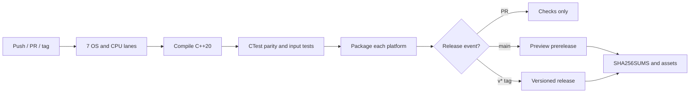

<div align="center">

# ⬟ PENTAGONAL XOR

### A tiny cross-platform C++20 parity engine with a mighty build matrix.

**Simply Well Executed** · **0BSD** · **No external runtime dependencies**

[](https://github.com/Simply-Well-Executed/pentagonal-xor-cpp20/actions/workflows/ship.yml)
[](https://github.com/Simply-Well-Executed/pentagonal-xor-cpp20/releases)
[](CMakeLists.txt)
[](LICENSE)
[](https://github.com/Simply-Well-Executed/pentagonal-xor-cpp20/actions)

**[⬇️ Browse downloadable releases](https://github.com/Simply-Well-Executed/pentagonal-xor-cpp20/releases)**  ·  **[⚙️ Watch live build matrix](https://github.com/Simply-Well-Executed/pentagonal-xor-cpp20/actions/workflows/ship.yml)**  ·  **[🛡️ Security policy](SECURITY.md)**

</div>

---

## ∞ The mathematics

Five continuous feature inputs `h₁...h₅ ∈ [0, 1]` fold into a recursive fuzzy-XOR parity result:

**`X₀ = 0`**

**`Xₖ = Xₖ₋₁ × (1 − hₖ) + (1 − Xₖ₋₁) × hₖ`**

An independent implementation enumerates every one of the **32 Boolean configurations** and sums the **16 odd-parity AND minterms**. The executable checks that both routes agree.

```text
INPUT   h1=0.80  h2=0.70  h3=0.90  h4=0.60  h5=0.95
OUTPUT  Recursive XOR : 51.72800000%
        32-state check: 51.72800000%
        Absolute error: 0.00000000
```

## 🧩 Include-free compatibility API

The [std-free C header](shared/pentagonal_xor_std_free.h) exposes the five-feature AND, OR, odd-parity XOR probability, partial, and fifth-root scores without standard headers, C++ standard-library dependencies, allocation, or platform APIs. It is compiled as strict C11 in the cross-platform shared-guard workflow.

On Windows, `SWE_PXOR_WINDOWS_LEGACY_TARGET` and `SWE_PXOR_USE_STDFREE_BACKEND` are selected from `_WIN32` and `_WIN32_WINNT`. This detects the **configured compiler target**, not the actual Windows version at runtime. The std-free header is portable and can be used on any supported platform.

PowerShell 7 build of the compatibility component:

```powershell
cmake -S .\\shared -B .\\shared\\build
cmake --build .\\shared\\build --config Release
ctest --test-dir .\\shared\\build -C Release --output-on-failure
```

---

## 🧰 Download matrix

Every successful build is packaged with the binary, documentation and 0BSD license. Release assets are named by OS and processor architecture.

| OS flavor | Architecture | Package |
|:--|:--|:--|
| 🐧 Ubuntu Linux | x86-64 | `pentagonal-xor-linux-x64.tar.gz` |
| 🐧 Ubuntu Linux | ARM64 | `pentagonal-xor-linux-arm64.tar.gz` |
| 🪟 Windows | x86-64 | `pentagonal-xor-windows-x64.zip` |
| 🪟 Windows | x86 / 32-bit | `pentagonal-xor-windows-x86.zip` |
| 🪟 Windows 11 (experimental) | ARM64 | `pentagonal-xor-windows-arm64.zip` |
| 🍎 macOS Intel | x86-64 | `pentagonal-xor-macos-x64.tar.gz` |
| 🍎 macOS Apple Silicon | ARM64 | `pentagonal-xor-macos-arm64.tar.gz` |

> Packages appear in Releases only after their corresponding GitHub Actions jobs succeed. Windows ARM64 is an experimental lane and can be unavailable.

## 🏁 Build it yourself

### PowerShell 7 (Windows, GCC)

```powershell
g++ -std=c++20 -O2 -Wall -Wextra -Wpedantic .\pentagonal_xor_cpp20.cpp -o .\pentagonal_xor_cpp20.exe
.\pentagonal_xor_cpp20.exe 0.80 0.70 0.90 0.60 0.95
```

### PowerShell 7 (CMake, cross-platform)

```powershell
cmake -S . -B build -DCMAKE_BUILD_TYPE=Release
cmake --build build --config Release --parallel
ctest --test-dir build -C Release --output-on-failure
```

### Bash (Linux / macOS)

```bash
cmake -S . -B build -DCMAKE_BUILD_TYPE=Release
cmake --build build --parallel
ctest --test-dir build --output-on-failure
./build/pentagonal_xor 0.80 0.70 0.90 0.60 0.95
```

## 🚀 The release conveyor belt



- **Pull requests** run compile, tests and artifact builds but cannot publish releases.
- **Commits to `main`** make a uniquely tagged **preview prerelease** when all non-experimental platforms pass.
- **Tags beginning with `v`** make versioned release assets.
- **`SHA256SUMS`** provides SHA-256 checksums for each downloadable archive.
- **Dependabot** checks GitHub Actions dependencies weekly. Issue forms and pull request templates help contributors.

## ⚖️ License and scientific limits

Copyright © 2026 **Paul Allen Cheek**. Licensed under [0BSD](LICENSE): reuse is permitted without mandatory attribution.

This is a mathematical parity engine, **not** a facial identity, age, genetic relationship, or provenance detector. The supplied feature values are chosen by the caller, and model output is not independent evidence of real-world relationships.

---

<div align="center"><sub>Made for reproducible experiments by Simply Well Executed. ⬟</sub></div>
