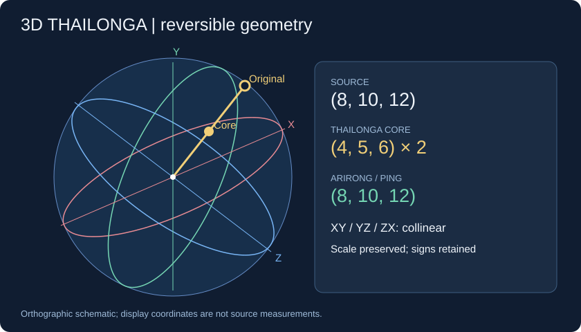
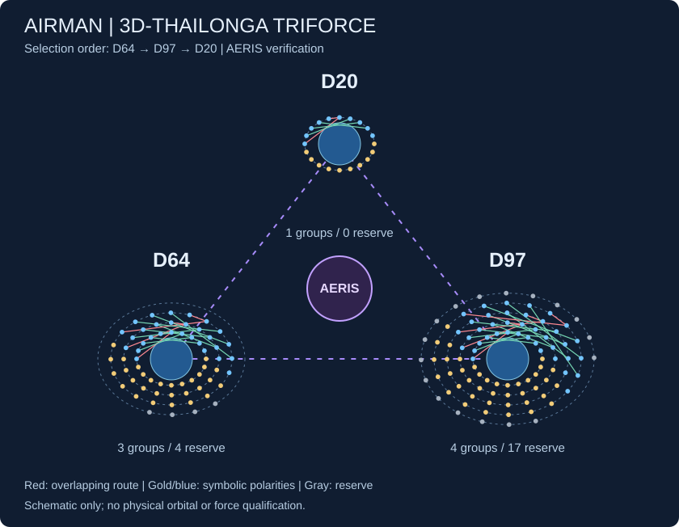
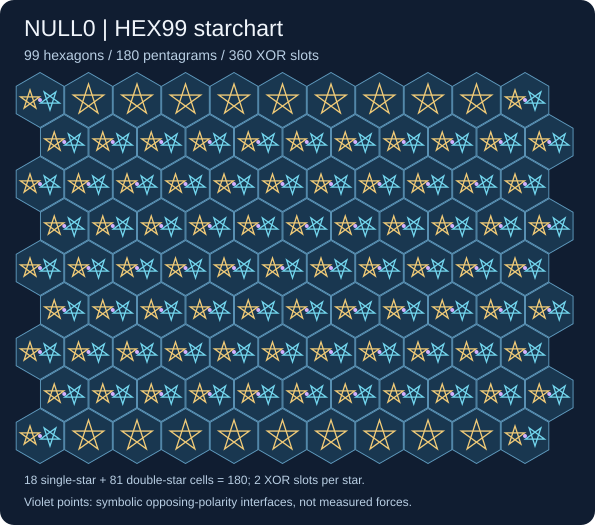

<!--
Copr.© 2026 by PAUL ALLEN CHEEK mail@pcheek.com C5824

Permission to use, copy, modify, and/or distribute this software for any purpose with or without fee is hereby granted.

THE SOFTWARE IS PROVIDED "AS IS" AND THE AUTHOR DISCLAIMS ALL WARRANTIES WITH REGARD TO THIS SOFTWARE INCLUDING ALL IMPLIED WARRANTIES OF MERCHANTABILITY AND FITNESS. IN NO EVENT SHALL THE AUTHOR BE LIABLE FOR ANY SPECIAL, DIRECT, INDIRECT, OR CONSEQUENTIAL DAMAGES OR ANY DAMAGES WHATSOEVER RESULTING FROM LOSS OF USE, DATA OR PROFITS, WHETHER IN AN ACTION OF CONTRACT, NEGLIGENCE OR OTHER TORTIOUS ACTION, ARISING OUT OF OR IN CONNECTION WITH THE USE OR PERFORMANCE OF THIS SOFTWARE.
-->

# AIRMAN | Exploration rollup
EXPLORATORY / RELEASE=HOLD. Source-preserving documentation; no new claim of physical validation.

## 3D-THAILONGA

For signed 32-bit coordinates (x,y,z), g=gcd(abs(x),abs(y),abs(z)). For nonzero vectors retain primitive=(x/g,y/g,z/g) and g. ARIRONG reconstructs exactly; AERIS is the verification role in this new model. Zero has scale zero and zero primitive; malformed or out-of-range reconstructions fail. XY/YZ/ZX are cross-product witnesses; PING checks exact restoration. Display transforms never alter source. Default example (8,10,12) -> (4,5,6), g=2. Missing measurements are not inferred. Independent of the existing anatomy viewer.

## ATTENUATION and Euler's jig
[Source](../shared/ATTENUATION.hpp). G=O-B; L=R-G; bridge=R-B; A=G+bridge. The mixed-category 103->167 example yields 64,36,-3,61 but is not comparable; total classified 103->200 yields gain 97, shortfall 3, scalar 94. Preserve the symbolic triple bar U+2261 and cross-through U+2260 as labels, not operators. With independently supplied square sides x,y, C=(R-G)/(x+y)=y-x when divisor nonzero and exact. Signed (8,10),(-8,-10),(8,-10),(-8,10) yield -34,-38,-54,-18 after compensation. Not dBi. Zero is one root; singular quotient invalid. Audio equalization is frequency-dependent gain/cut, not this scalar.

## Globe, configuration and constellation
5D display state=(x,y,D,C,J); D=x*x-y*y, C=y-x, J=D+C. D6/D7 squares, D8 divisor, D9 remainder, D10/D11 sign labels. These are dependent state coordinates, not independent spatial dimensions. Orthogonal display rotations and normalization are visual only. For n binary selection axes there are 2^n configurations including empty selection, 2^n-1 nonempty subsets, n(n-1)/2 coordinate planes. D5..D11 counts: 31,63,127,255,511,1023,2047. At 11 axes there are 462 five-coordinate subsets and 462 six-coordinate subsets. The proposed 1:1 mapping is a chosen selection-ID convention, not a universal identity.

## Orbital laboratory

D1..D10 positive labels; D11..D20 negative labels. Routes 11->16,12->17,13->18,14->19,15->16: repeated 16, unused 20. Exclusive matching fails. Replacing final destination with 20 changes one route and retains four. Enumeration: 5^5=3125 assignments, 5!=120 exclusive, 3005 overlapping. TRIFORCE layout: D20 apex; D64 lower left; D97 lower right. Selection order D64, D97, D20; AERIS at the center is verification, not another satellite group. D20,40,64,80,97 group/reserve counts 1/0,2/0,3/4,4/0,4/17. Symbolic labels are not charges or human identities. Like charges repel, unlike attract; negative times negative is positive arithmetic, not physical charge conversion. Neither D64 nor D97 establishes a real orbital capacity or military standard. Illustrative energy budget: 100 Wh stored, 50 W load, 80 W sunlight generation, 90-minute schematic cycle with 54 min sunlight and 36 min eclipse. Stored-only reaches zero at 120 min under constant load. Actual spacecraft use solar power and energy storage; capacitors cannot generate energy. No orbit dynamics or collision safety verified.

## NULL0 starchart

99 hexagonal cells (not a 99-gon), 18 single-star and 81 double-star cells =180 pentagrams, each with two slots =360. 9 rows x11 columns is a proposed display arrangement, not a proven tessellation. Eleven bits select columns; all 2048 selection IDs are preserved including empty. Opposing and parallel orientations are distinct visual options. NULL0 is the proposed bipolar interaction interface, distinct from selection ID zero, configuration and constellation. DELTA=(a XOR b) AND 2047; BIAS=2047 XOR DELTA. BIAS records unchanged bits, not correctness. Separate force magnitude for ideal separated point charges is k abs(q1*q2)/r^2; neutral total charge need not mean zero force. No physical force calculation follows from labels alone.

## Protocol custody
CHOSEN, NEVER ASSUMED. The fictional NULL0 chamber exercise ended with no verified response or external transmission. The user explicitly closed it; no retries, external endpoint, independent entity or extraterrestrial communication are asserted. Prior definitions are historical; interface definition is exploratory, not a DOGMA amendment. Mongolian conversational acknowledgement: Заа (Zaa); Chinese 好哒 (HAODA).

## Qualification
[THAILONGA3D](../shared/THAILONGA3D.hpp), [NULL0 topology](../shared/NULL0_TOPOLOGY.hpp), [tests](../tests/THAILONGA3D_TEST.cpp). The CTest target covers 35,937 signed triples, 3,125 pairing assignments and 4,194,304 mask pairs. The SVGs include accessible descriptions and no embedded scripting. Native airman_viewer provides standard Win32 controls for the XYZ source, original/core, quarter-turn rotation, 11-bit mask, D64/D97/D20 TRIFORCE selection, pairing repair and signed Euler jig. It is a separate fixed-size native viewer, not a replacement for DIAERY or a browser app. Native state-chart mode steps through 5D–11D coordinate counts and retains signed branch values. The energy mode uses exact watt-minutes and selectable 10-minute time steps, with solar/storage-only switching. Full continuous higher-dimensional globe rotation, animated orbit propagation and continuous energy sliders remain exploratory, not implemented in this native viewer. Screen reader and keyboard-device qualification remain pending. Existing DIAERY behavior and frozen SILVERHAND test inventory remain unchanged. Native build and assistive-technology qualification pending.
