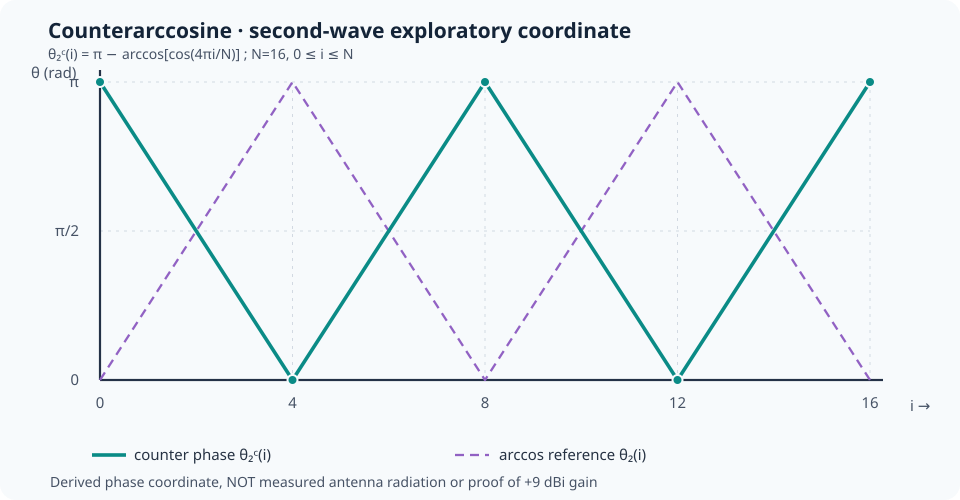

# COREAO RF gain: input → +9 dBi → EIRP output

> **Document status: DUE FOR UPDATE (2026-11-19).** Verify claims against code and tests; sharpen active verbs; check copyright, project-mark language, accessibility, and 0BSD scope. This mark is not a failure verdict. See [DOCUMENT_REVIEW_REGISTER.md](DOCUMENT_REVIEW_REGISTER.md) and [LICENSE_AND_MARKS.md](LICENSE_AND_MARKS.md).
>
> **Original contributions:** Copyright (c) 2026 Paul Allen Cheek · SPDX-License-Identifier: 0BSD. Third-party material and marks retain their respective rights; no registered mark is asserted.


**Status:** experimental, domain-scoped, original 0BSD C++20 mathematical
operator. This is a **calculation**, not a physical measurement or a
claim of higher transmitter power. Its provenance and scope are distinct
from DecaSigma, COREAO numerical audits, Coreo stereo, and Stability-10D.

## Exact operator and source custody

```text
INPUT     source conducted power P_in, in watts (W)
GAIN      fixed antenna reference gain +9 dBi
OUTPUT    effective isotropic radiated power (EIRP), in watts (W)
REVERSE   reconstructed P_in = EIRP / gain_linear
AUDIT     largest normalized discrepancy between source and reconstruction
```

For a matched, idealized transmit path with no feedline, connector, or
other losses:

```text
power gain relative to isotropic = 10^(9/10) = 7.943282347242816
EIRP[W] = P_in[W] × 7.943282347242816
recovered_P_in[W] = EIRP[W] / 7.943282347242816
```

dBi is a logarithmic *directional* antenna gain reference. EIRP is the
power an ideal isotropic radiator would need to radiate to produce the
same power flux density in the specified reference direction. It is not
the sum of power radiated in all directions and is not an amplifier that
creates additional transmitter power. Under comparable far-field
conditions, the corresponding **field-amplitude ratio** is
`sqrt(10^(9/10)) ≈ 2.818382931264454`; that ratio is not an
audio amplitude multiplier.

**The 0BSD input W remains the authoritative source record.** The
derived EIRP, reconstructed input, and normalized residual are not
permitted to overwrite it. On negative, nonfinite or unrepresentable
numeric input, `admissible=false`; the default zero fields do not
represent a successful measurement or evaluation.

## Implementation

`shared/coreao_gain.hpp` lives in
`namespace swe::coreao::rf_gain` and includes the existing COREAO
header for its normalized error comparison. It does not change
`shared/coreao.hpp` or the Pentagonal XOR parity kernel.

```cpp
#include <swe/coreao_gain.hpp>
auto witness = swe::coreao::rf_gain::apply(1.0); // input conducted watts
if (witness.passed()) {
    // witness.gain_dbi = +9
    // witness.output_eirp_watts ≈ 7.943282347 W
    // witness.recovered_input_watts ≈ 1.0 W
}
```

The gain factor is a fixed, documented binary64 constant to permit an
include-free, allocation-free public API. The calculation uses no
transceiver, DSP, radio control, device access, IO or online service.
It assumes an ideal zero-loss path and does not account for bandwidth,
frequency, antenna geometry, impedance mismatch, polarization,
installation losses, nearby scatterers, duty cycle, local regulations
or real antenna radiation patterns.

If downstream users need a real system link budget, they must provide
measured, frequency-specific antenna gain, feedline loss, and any
other link-budget components. Adding `+9 dBi` to a signal without a
physical antenna and reference direction does not magically create
more radio power or better audio transcription.

## Numerical examples

| Input (conducted) | Gain | Output EIRP |
|---|---|---|
| 0 W | +9 dBi | 0 W |
| 1 mW | +9 dBi | approx. 7.943282 mW |
| 1 W | +9 dBi | approx. 7.943282 W |


## White paper · Counterarccosine2ndwave coordinate study

**Protocol designation:** \`COREAO-RF-9dBi-CounterArccosine2ndWave-EXPLORATORY-v1\`.

**Claim levels are deliberately separate.** The gain relation is ordinary RF link-budget mathematics. The *counterarccosine second-wave* is a **new, explicitly defined visualization/optional stimulus envelope**, not an established RF antenna gain law, physical discovery, or independent demonstration that a radio device achieves +9 dBi. The name is a descriptive proposal; the experiment has not been peer reviewed.

### 1. Coordinates, domain, and the plotted second wave

Take an integer sample index \`i\` running from \`0\` to \`N=16\`; the **horizontal axis is \`x=i\`**. The vertical coordinate is phase angle in radians, **marked in multiples of \`π\`** (\`0\`, \`π/2\`, \`π\`). Define the principal inverse cosine \`arccos : [-1,1] → [0,π]\` and the second harmonic phase:

\`\`\`text
Reference second wave: θ₂(i) = arccos(cos(4πi/N)).
Counter second wave:   θ₂ᶜ(i) = π − θ₂(i).

For every index i:      θ₂(i) + θ₂ᶜ(i) = π.
\`\`\`

The cosine argument is \`4πi/N\`: precisely **two full periods** across the \`N\`-sample interval. \`arccos(cos(t))\` folds the angle into the principal interval and creates a **triangular phase trajectory**, rather than an ordinary sinusoid. The counter transformation reflects it about \`π/2\`.



*Graph provenance:* generated deterministically from the expressions above using 257 points for each polyline over \`0≤i≤16\`. Green is \`θ₂ᶜ\`; dashed purple is \`θ₂\`. The plotted graph is conceptual and **not RF field-strength measurement data**.

| i | θ₂(i) | θ₂ᶜ(i) |
|---:|:---:|:---:|
| 0 | 0 | π |
| 4 | π | 0 |
| 8 | 0 | π |
| 12 | π | 0 |
| 16 | 0 | π |

### 2. Connect the plotted coordinates to input, gain, and output without conflation

Let \`P_in(i)\` be an external, nonnegative **measured or specified conducted-input power in watts**. A fixed \`+9 dBi\` antenna reference gain becomes the linear factor:

\`\`\`text
G = 10^(+9/10) = 7.943282347242816
P_EIRP(i) = G · P_in(i), assuming zero feedline/connector losses
COREAO inverse witness: P̂_in(i) = P_EIRP(i) / G
COREAO discrepancy: |P̂_in(i)/s − P_in(i)/s|,
where s = max(1, |P̂_in(i)|, |P_in(i)|).
\`\`\`

**The phase graph does not imply that \`P_in\` has changed.** If \`P_in(i)\` is constant, the ideal EIRP remains constant even as the conceptual phase trace oscillates. It is invalid to claim a gain enhancement *because* the plotted wave has two periods. The operator \`swe::coreao::rf_gain::apply\` does not use this graph as a secret gain multiplier and does not mutate source power.

For an **optional, separately labeled mathematical experiment**, one may prescribe a nonnegative synthetic input envelope:

\`\`\`text
u(i) = sin²(θ₂ᶜ(i)/2)  ∈ [0,1]
P_in,synthetic(i) = P₀ · u(i)
P_EIRP,synthetic(i) = 10^(9/10) · P₀ · u(i)
\`\`\`

This choice gives \`P_in,synthetic(0)=P₀\`, \`P_in,synthetic(N/4)=0\`, and \`P_in,synthetic(N/2)=P₀\` by design. It is a **constructed test waveform**, not an inferred antenna radiation pattern. This optional envelope is *not* part of the C++ gain API.

### 3. Falsifiability, limits, and reproducibility

1. **Algebraic verification:** \`10^(9/10)\` must independently match the binary64 gain constant in \`shared/coreao_gain.hpp\` to numerical tolerance. Reverse reconstruction must agree with the unmodified input.
2. **Graph witness:** for \`N=16\`, the five known phase checkpoints in the table are exact; in addition, \`θ₂+θ₂ᶜ=π\` for every sampled index. No arbitrary peak-fitting or post-hoc coordinate edits.
3. **Physical validation not yet performed:** real gain requires a calibrated antenna-range measurement, frequency, polarization, matching, radiation direction, feeder losses, and uncertainty budget. The code currently takes no instrument samples. Neither its synthetic tests nor this chart establish physical +9 dBi realized gain.
4. **Audio/ASR independence:** radians of plotted phase, logarithmic antenna gain and the Stability-10D acoustic scalar are different quantities. Do not use this wave to assert model-free speech recognition, new watts of transmitter power, or an RF-regulatory exemption.
5. **Provenance:** keep original phase inputs, sample count, gain reference, test protocol version, and derived graph distinct. A failed test remains a historical finding; changing the graph definition requires a new protocol version.

### 4. External engineering reference

For conventional dimensional grounding, the [CDC/NIOSH technical explanation of antenna gain](https://archive.cdc.gov/www_cdc_gov/niosh/mining/content/emergencymanagementandresponse/commtracking/advcommtrackingtutorialb.html) gives \`g = 10^(G_dBi/10)\`. The [ITU-T K.91 guidance](https://www.itu.int/epublications/es/publication/itu-t-k-91-2024-01-guidance-for-assessment-evaluation-and-monitoring-of-radio-frequency-electromagnetic-fields/en) treats antenna gain and feeder losses separately. **Neither establishes the exploratory counterarccosine model**: that contribution is explicitly defined and visually reproducible here, without asserting standards endorsement.


## Validation and boundary

`tests/coreao_gain_test.cpp` checks the results independently against
the standard-library `pow(10,0.9)` reference, compares equivalent
amplitude ratio against `sqrt(pow(10,0.9))`, verifies the inverse
input witness and unchanged original COREAO round-trip, and exercises
negative, NaN, infinite, overflow and invalid-tolerance cases.

`tests/consumer/main.cpp` compiles and executes the *installed*
`swe/coreao_gain.hpp` API on the multi-OS CI matrix.

**Release status:** new PR #4 changes are subject to the latest
cross-platform CI run. Original failures remain visible; a subsequent
successful rerun does not rewrite a prior red result. No tag, merge,
or production Android signing is implied by this mathematical addition.
