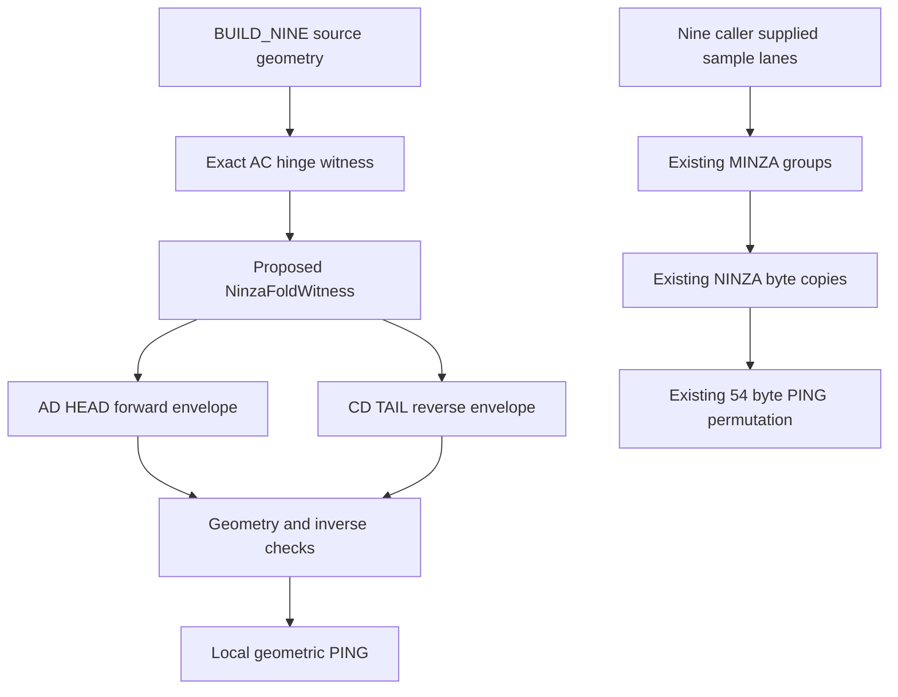

# MINZA–NINZA–PING: C++20 Topology Design

Implement the exact nine-triangle construction and its AC hinge witness as an additive C++20 layer. Preserve AD and CD as distinct, labeled squared-length records, carry them through every documented 6–9 XDR/RDX stage, and require geometry and inverse reconstruction to agree before PING succeeds. Keep the existing 54-byte MINZA → NINZA → PING pipeline as a separate API.

The proposed code in this PR reuses the pinned source headers and adds compile-time checks and executable tests. STAR means the requested `*` wildcard over the applicable documented variants; it does not introduce a star-shaped geometry or an unbounded operator.

This document records the source-grounded design. The added incidence header, two executable examples, CMake targets and CI qualification script live alongside it in this PR. The original source headers remain in place.

## Baseline base and PR source view

The source view used to derive this design is the November 23, 2026 PR base plus PR #95's diff, pinned before the topology commit. [PR #95](https://github.com/Simply-Well-Executed/pentagonal-xor-cpp20/pull/95) is the integration branch. The pinned revisions below remain the provenance for inherited definitions as the PR head advances.

| Source | Frozen revision and relationship |
| --- | --- |
| PR base and merge base | `7397373d1bcfa05762b9e946431ae90dcabbe157` on `feat/jstar-msvc-process-provenance-20261121` |
| PR #95 head | `5c61689d49fcfa7e0629af7f35eeb5078bc03f91` on `feat/quaddi-ni-oracle-cpp20-20261123` |
| Diff applied to that base | 90 commits ahead, 0 behind, 57 changed files; see the [exact compare](https://github.com/Simply-Well-Executed/pentagonal-xor-cpp20/compare/7397373d1bcfa05762b9e946431ae90dcabbe157...5c61689d49fcfa7e0629af7f35eeb5078bc03f91) |
| Inherited topology | `u_circle_fit.hpp`, fold-tork, direct BiDi/TriDi and three-fold headers were unchanged at the pinned PR head; this follow-on commit adds a topology header and updates root CMake |
| PR inspiration | Additive numeric-width, constant-format and validation work; preserve existing source contracts and attach explicit validation evidence |

The original request r1 text is absent from the retrievable “Sigma formulas explained” history. The contracts below are grounded in the inspected repository snapshot. Reconcile r1 before treating a newly proposed adapter as the original symbolic definition.

## Definitions and mathematical meaning

| Name | Source-grounded meaning | Implementation consequence |
| --- | --- | --- |
| `BUILD_NINE()` | Nine triangular regions partition the square `[0,60] × [0,60]` in three horizontal strips | Retain the exact source coordinates and face indices |
| Geometric MINZA | Source geometry in the direct-fold adapter | Identify the first-strip triangles and shared AC hinge explicitly |
| Geometric NINZA | The fold documentation names the sequence, but no general geometric NINZA state contract is supplied | `NinzaFoldWitness` below is a proposed local record, with no claim to define all NINZA uses |
| Geometric PING | Exact direct-fold and envelope consistency predicates | A successful check establishes those local predicates |
| `AD_FOLDED`, `CD_FOLDED` | Squared distances multiplied by 169: 67,600 and 152,100 | They are scalar witnesses associated with edges, not edge coordinates or whole boundary objects |
| XDR/RDX 6–9 | User-named rotate/XOR word adapters with explicit inverses | Preserve stage order and word width; these are not ONC-XDR serialization |
| HEAD and TAIL | AD and CD role-specific envelopes | Keep roles, original values, encoded words and tags together |
| BiDi and TriDi | Explicit swaps/cycles in the relevant namespace | Distinguish the AIRGAP-marker cycle from the later three-geometric-edge cycle |

These names are project terminology. Ordered faces, oriented boundaries, incidence, rigid rotation, quotient gluing and Euler characteristic are established mathematical concepts. Their definitions do not independently assign semantics to MINZA, NINZA or PING. [Grid source](https://github.com/Simply-Well-Executed/pentagonal-xor-cpp20/blob/5c61689d49fcfa7e0629af7f35eeb5078bc03f91/shared/u_circle_fit.hpp), [fold-tork source](https://github.com/Simply-Well-Executed/pentagonal-xor-cpp20/blob/5c61689d49fcfa7e0629af7f35eeb5078bc03f91/shared/xdr_rdx_fold_tork.hpp), [direct-fold source](https://github.com/Simply-Well-Executed/pentagonal-xor-cpp20/blob/5c61689d49fcfa7e0629af7f35eeb5078bc03f91/shared/minza_direct_ping_bidi.hpp).

## Exact nine triangle construction

For strip `i = 0,1,2`, set `y0 = 20*i`, `y1 = y0+20`, `j = 3*i`. The source creates:

```cpp
result.face[j]   = {{0,y0}, {60,y0}, {30,y1}};
result.face[j+1] = {{0,y0}, {0,y1},  {30,y1}};
result.face[j+2] = {{60,y0},{60,y1}, {30,y1}};
```

Each strip has areas 600, 300 and 300, so total area is 3,600 square grid units and total doubled area is 7,200. The signed doubled areas are `1200,-600,600` per strip: source winding is mixed. The stored `BASE_CIRCLE{60,60,7200}` has doubled center `(60,60)`, hence center `(30,30)`, and stores four times the radius squared. Its radius squared in ordinary grid units is 1,800. Preserve that doubled-coordinate convention rather than interpreting 7,200 as the ordinary radius squared. [Exact implementation](https://github.com/Simply-Well-Executed/pentagonal-xor-cpp20/blob/5c61689d49fcfa7e0629af7f35eeb5078bc03f91/shared/u_circle_fit.hpp).

At `y=20` and `y=40`, a long edge from x=0 to x=60 meets two source edge segments split at x=30. This is a T-junction in a triangle-only adjacency model. A derived conforming cell-incidence view must split the long edge at every existing collinear vertex. Keep the nine face regions and their source triples unchanged; some derived face boundaries then have four segments. A strict simplicial triangulation would require additional face splits and different face counts.

### Derived mesh invariants

For the normalized nine-face cell view, exact integer counting gives 11 vertices, 19 edges, nine faces, nine boundary segments and ten interior segments. Interior segments occur twice with opposite signs; boundary segments occur once. These are derived fixture checks, not pre-existing repository assertions.

```math
\chi = V-E+F = 11-19+9 = 1,\qquad
\partial_1\partial_2 = 0.
```

The normalization code locally reverses clockwise traversal for incidence bookkeeping without changing source face order. It rejects duplicate faces, degenerate triangles and coordinates outside the source domain; the BASE9 profile check also detects the test's changed shared junction. The equation for χ and the incidence ledger do not by themselves prove absence of overlaps, connectedness, a manifold vertex link, or topology equivalence. [Oriented boundaries and Euler characteristic, Hatcher Chapter 2](https://pi.math.cornell.edu/~hatcher/AT/ATch2.pdf).

## Hinge transformation and folded boundaries

Use the first large face and left small face: `A=(0,0)`, `B=(60,0)`, `C=(30,20)`, `D=(0,20)`. The moving triangle is ADC; AC is fixed. Set `u=C-A`, `v=D-A`. The source gives `u·u=1300`, `u·v=400`, and the planar cross product 600. For the pinned 90-degree rotation:

```math
D' = A + u\frac{u\cdot v}{u\cdot u} + z\hat{k},\qquad
z^2 = \frac{\operatorname{cross}(u,v)^2}{u\cdot u}.
```

The exact stored representation is `x=120/13`, `y=80/13`, `z²=46800/169`. This avoids rounding a square root. Squared z does not determine whether the fold goes above or below the plane; retain the fold sign separately if orientation matters.

```math
AD^2=400,\quad CD^2=900,\quad AC^2=1300,
\qquad AD_{FOLDED}=169\cdot400=67600,
\quad CD_{FOLDED}=169\cdot900=152100.
```

AC's scaled squared witness is 219,700. This particular right triangle also satisfies `AD_FOLDED + CD_FOLDED == AC_FOLDED`. Do not force HEAD and TAIL equal: their distinct lengths are correct. [Direct geometry](https://github.com/Simply-Well-Executed/pentagonal-xor-cpp20/blob/5c61689d49fcfa7e0629af7f35eeb5078bc03f91/shared/minza_direct_ping_bidi.hpp), [three-edge witnesses](https://github.com/Simply-Well-Executed/pentagonal-xor-cpp20/blob/5c61689d49fcfa7e0629af7f35eeb5078bc03f91/shared/minza_direct_ping_tridi.hpp).

Treat AD and CD as labeled boundary edges of the moving facet. Store their endpoints and mesh incidence separately from their scalar witnesses. Geometric coincidence is not topological identification: no vertex merge, bonded seam or quotient space follows from a matching length. A gluing operation needs an explicit endpoint map and orientation. [Attaching maps, Hatcher Chapter 0](https://pi.math.cornell.edu/~hatcher/AT/ATch0.pdf).

## Data structures and state flow

| Layer | Existing or proposed representation | Required checks |
| --- | --- | --- |
| Source geometry | Existing `Point`, `Triangle2`, `NineTriangles` | Exact source face indices, bounded coordinates, nonzero areas |
| Derived topology | Proposed `View` with vertex table, undirected edge IDs, incidence counts and signed balance | Split T-junctions; preserve source coordinates; normalize derived winding |
| Fold state | Existing `DirectFold` with x13, y13, z2_169, squared distances and validity flags | Recompute geometry and compare expected exact values |
| Proposed geometric NINZA | `NinzaFoldWitness` containing `DirectFold`, HEAD envelope and TAIL envelope | Geometry must agree with both labeled original envelope values |
| Local PING result | Geometry predicate AND HEAD predicate AND TAIL predicate | Reject changes to values, roles, payloads or local tags |
| Byte pipeline | Existing `Minza`, `Ninza`, `Ping`, `Report` | Preserve nine lanes, six bytes per lane, mirror comparison and 54-position bijection |



The current direct-fold adapter explicitly allows MINZA → PING without a NINZA intermediary for this one sample. The proposed record provides an inspectable intermediate state for the requested design; it does not remove or reinterpret that existing direct route.

## Wildcard coverage for XDR and RDX

Expand `*` over all applicable documented stages `{6,7,8,9}`, both inverse compositions and both AD/CD source witnesses. Do not treat `*` as a new C++ operator, a stage outside that set, or the unrelated `STAR[5]` pentagram fixture in the grid header.

```math
\begin{aligned}
M_s &= \mathtt{0x9E3779B97F4A7C15}\ \operatorname{XOR}\ (s\cdot\mathtt{0x0101010101010101}) \\
X_s(v) &= \operatorname{rotl}_{64}(v\operatorname{XOR}M_s,s) \\
R_s(v) &= \operatorname{rotr}_{64}(v,s)\operatorname{XOR}M_s
\end{aligned}
```

For stages 6–9, both `R_s(X_s(v)) == v` and `X_s(R_s(v)) == v`. XORing twice with the same mask cancels; the two rotations are inverse. Thus the identities hold for every 64-bit word under the source's width assumptions, beyond the finite test vectors.

| Route | Execution order | PING reconstruction |
| --- | --- | --- |
| HEAD from AD | XDR6 → XDR7 → XDR8 → XDR9 | RDX9 → RDX8 → RDX7 → RDX6 |
| TAIL from CD | RDX9 → RDX8 → RDX7 → RDX6 | XDR6 → XDR7 → XDR8 → XDR9 |
| Each individual stage | All of 6, 7, 8, 9, tested on both source witnesses and four other words | Both inverse compositions |
| Interleaved stress | Every accepted round count 1 through 4096 | Undo rounds in reverse order; reject 0 and 4097 |

The source's low-level XDR/RDX functions return the input for an invalid stage. The example's new `stage_word` adapter rejects invalid stages and leaves the output untouched. The source rotation helpers assume valid nonzero shifts below 64; keep arbitrary callers behind checked adapters. Local tags are deterministic consistency checks, not authentication. [Stage and envelope implementation](https://github.com/Simply-Well-Executed/pentagonal-xor-cpp20/blob/5c61689d49fcfa7e0629af7f35eeb5078bc03f91/shared/xdr_rdx_fold_tork.hpp).

### Related fold operators covered by the wildcard

The fold-tork namespace also implements the following local adapters. Their existing source assertions compile as part of the geometry example; these definitions remain scoped to this experiment.

| Adapter | Exact local behavior and invariant |
| --- | --- |
| BiDi | Swap the two labeled lanes; applying it twice restores the original pair |
| TriDi in fold-tork | Cycle HEAD, TAIL and an explicit AIRGAP marker; three cycles restore order |
| TriDi in direct geometry | Cycle AD, CD and AC geometric witnesses; this is a separate typed interpretation |
| PiSigma and TALON | Store an ordered pair of distinct source branches, then recover the pair without merging identities |
| PiDi | `PI_SYMBOL % 4 == 3`, using the source integer `314159265358979323`; this is symbolic integer metadata, not the irrational mathematical π |
| SigmaPi | C++ logical `!PI_SYMBOL == false`, retained as symbolic metadata |
| SigmaSigma | Require both labeled envelope PING checks and both exact scaled squared-distance identities |
| SigmaSigmaSigma | Require SigmaSigma, BiDi/TriDi restoration, the Pi-family metadata and the stress roundtrip together |
| COLLIDE and SEPARATE | Mix both encoded words reversibly; reverse the same rounds in reverse order to recover both words |

These adapters provide explicit consistency predicates. They do not supply missing geometric state transitions or a general gluing rule. [Pinned fold-tork source](https://github.com/Simply-Well-Executed/pentagonal-xor-cpp20/blob/5c61689d49fcfa7e0629af7f35eeb5078bc03f91/shared/xdr_rdx_fold_tork.hpp).

## Compilable C++20 geometry example

The following complete test translation unit uses the inherited headers and `shared/minza_topology_incidence.hpp` in this repository. It uses no standard-library types in the geometry layer. Its geometric NINZA record and checked stage adapter are proposed additions; all `swe::` operations call the preserved source implementation.

```cpp
// SPDX-License-Identifier: 0BSD
// Proposed geometric NINZA witness is scoped to the pinned AC fold.
#include "../shared/sigma_form_area_q62.hpp"
#include "../shared/right_triangle_f123_original.hpp"
#include "../shared/sigma_f_redaxualchoice.hpp"
#include "../shared/four_pyramid_reduxualchoice.hpp"
#include "../shared/u_circle_fit.hpp"
#include "../shared/xdr_rdx_fold_tork.hpp"
#include "../shared/minza_direct_ping_bidi.hpp"
#include "../shared/minza_direct_ping_tridi.hpp"
#include "../shared/three_geometric_folds.hpp"
#include "../shared/minza_topology_incidence.hpp"

namespace topology_design {
namespace grid = swe::u_circle_fit;
namespace fold = swe::minza_direct_ping_bidi;
namespace tork = swe::xdr_rdx_fold_tork;
using u64 = unsigned long long;

// A proposed geometric NINZA adapter, not the existing byte Ninza type.
struct NinzaFoldWitness {
    fold::DirectFold geometry;
    tork::Envelope head;
    tork::Envelope tail;
};
constexpr NinzaFoldWitness make_witness() noexcept {
    const auto f = fold::MINZA_TO_PING();
    return {f, tork::HEAD(f.ad_folded), tork::TAIL(f.cd_folded)};
}
constexpr bool ping(const NinzaFoldWitness& n) noexcept {
    return fold::PING(n.geometry) &&
        n.head.original.value == n.geometry.ad_folded &&
        n.tail.original.value == n.geometry.cd_folded &&
        tork::PING_HEAD(n.head) && tork::PING_TAIL(n.tail);
}
constexpr auto ninza = make_witness();
static_assert(ping(ninza));
static_assert(grid::SUM_NINE_DOUBLE_AREA() == 7200ULL);
static_assert(fold::FOLD.ad_folded == 169ULL * 400ULL);
static_assert(fold::FOLD.cd_folded == 169ULL * 900ULL);

// The source low-level API returns its input for invalid stages.
// This proposed public adapter rejects them and preserves the output.
constexpr bool stage_word(u64 value, unsigned stage, bool inverse,
                          u64& output) noexcept {
    if (stage < 6u || stage > 9u) return false;
    output = inverse ? tork::RDX(value, stage) : tork::XDR(value, stage);
    return true;
}
constexpr bool wildcard_roundtrips() noexcept {
    constexpr u64 values[] = {0ULL, ~0ULL, 1ULL << 63u,
        0x0123456789ABCDEFULL, tork::AD_FOLDED, tork::CD_FOLDED};
    for (unsigned stage = 6u; stage <= 9u; ++stage)
        for (u64 value : values) {
            if (tork::RDX(tork::XDR(value, stage), stage) != value ||
                tork::XDR(tork::RDX(value, stage), stage) != value)
                return false;
        }
    u64 untouched = 17ULL;
    return !stage_word(4ULL, 5u, false, untouched) && untouched == 17ULL &&
        !stage_word(4ULL, 10u, true, untouched) && untouched == 17ULL;
}
constexpr bool rejects_mutations() noexcept {
    auto geometry = ninza;
    geometry.geometry.ad_folded ^= 1ULL;
    auto payload = ninza;
    payload.head.encoded ^= 1ULL;
    auto tag = ninza;
    tag.tail.tag ^= 1ULL;
    auto role = ninza;
    role.head.original.source = tork::Source::CD;
    auto equalized = ninza;
    equalized.geometry.cd_folded = equalized.geometry.ad_folded;
    return !ping(geometry) && !ping(payload) && !ping(tag) &&
        !ping(role) && !ping(equalized) &&
        !tork::PING_HEAD(ninza.tail) && !tork::PING_TAIL(ninza.head);
}
static_assert(wildcard_roundtrips());
static_assert(rejects_mutations());
static_assert(tork::EQUAL(tork::BIDI(tork::BIDI(tork::INPUT_PAIR)),
                          tork::INPUT_PAIR));
static_assert(swe::minza_direct_ping_tridi::REPORT.valid);
static_assert(swe::three_geometric_folds::WITNESS.valid);
static_assert(!swe::three_geometric_folds::SEALED_SEAM_VERIFIED);
}

int main() {
    if (!topology_design::wildcard_roundtrips()) return 1;
    if (!topology_design::rejects_mutations()) return 2;
    if (!topology_design::ping(topology_design::make_witness())) return 3;
    if (!swe::minza_topology::base9_profile(swe::u_circle_fit::BASE9) ||
        !swe::minza_topology::negative_witnesses()) return 4;
    // Exhaust the source's finite accepted round-count domain at runtime.
    for (unsigned rounds = 1u; rounds <= 4096u; ++rounds)
        if (!swe::xdr_rdx_fold_tork::PING_STRESS(rounds)) return 5;
    if (swe::xdr_rdx_fold_tork::PING_STRESS(0u) ||
        swe::xdr_rdx_fold_tork::PING_STRESS(4097u)) return 6;
    return 0;
}
```

### Compile time validation and tests

`shared/minza_topology_incidence.hpp` supplies the bounded side-splitting and incidence implementation. Its `static_assert`s check the normalized profile and deliberate invalid fixtures. C++20 `constexpr` permits a function to run during constant evaluation; the `static_assert` forces the relevant expression to be evaluated then. Imported runtime data still needs validation, and arithmetic bounds must be checked before evaluating products or indexing. [C++20 draft N4861, constant expressions](https://timsong-cpp.github.io/cppwp/n4861/expr.const).

| Test family | Coverage and expected result |
| --- | --- |
| Geometry | Exact source area, AC hinge, AD/CD/AC scaled squared lengths and retained identity |
| Derived cell incidence | V=11, E=19, F=9; boundary=9, interior=10; opposite interior signs and boundary-of-boundary zero |
| Mesh negative fixtures | Degenerate, duplicate and out-of-domain inputs are rejected; the changed junction fails the BASE9 profile |
| Stage wildcard | Six words × four stages × two compositions = 48 inverse identities; invalid stages 5 and 10 rejected |
| Envelope negatives | Changed geometry, encoded bit, tag bit, source role, equalized AD/CD and swapped envelopes fail |
| Stress wildcard | All 4,096 accepted round counts pass; counts 0 and 4097 fail |
| Existing order operations | BiDi twice restores; source TriDi checks compile; three-distinct-hinge witness remains valid |

The three-geometric-fold example uses a separate eight-triangle, four-panel partition with hinges at y=15,30,45. Its free seam becomes coincident but remains unbonded, and its tube has no end caps. It is not a three-cycle of witness labels, a transformation of BASE9 into a cube, or a verified physical paper fold.

## Existing MINZA NINZA PING byte example

The existing byte API groups lanes `0,1,2`, `3,4,5`, `6,7,8` into MINZA records. NINZA holds two identical 9×6 byte copies. PING applies a column-dependent bijection to 54 bytes. For zero-based column `c` and position `p`, `s=(p+c)%9`, with source lane `s` for even c and `8-s` for odd c. The inverse writes each braided byte back to that lane and column.

`unforge` compares both NINZA copies without choosing a winner. `untwirl` reconstructs the bytes and separately compares them with primary and cached restored data. Duplicated data and an invertible permutation add no independent evidence or entropy. No source-grounded mapping connects these byte lanes to geometric AD/CD edges. [Producer](https://github.com/Simply-Well-Executed/pentagonal-xor-cpp20/blob/5c61689d49fcfa7e0629af7f35eeb5078bc03f91/shared/sigma_penta_ping.hpp), [read-only inverse](https://github.com/Simply-Well-Executed/pentagonal-xor-cpp20/blob/5c61689d49fcfa7e0629af7f35eeb5078bc03f91/shared/minza_ninza_ping_unfold.hpp), [byte contract](https://github.com/Simply-Well-Executed/pentagonal-xor-cpp20/blob/5c61689d49fcfa7e0629af7f35eeb5078bc03f91/docs/NINZA_PING_UNFORGE_UNTWIRL.md).

```cpp
// SPDX-License-Identifier: 0BSD
// Separate host-side test: this source intentionally uses the existing STL API.
#include "../shared/minza_ninza_ping_unfold.hpp"

namespace pipeline = swe::sigma_penta_ping;
namespace unfold = swe::sigma_penta_ping::unfold;

int main() {
    pipeline::Input input{};
    for (unsigned lane = 0; lane < pipeline::loops; ++lane)
        for (unsigned field = 0; field < pipeline::fields; ++field)
            input.samples[lane].pixel[field] =
                static_cast<std::uint8_t>((lane * 29u + field * 47u) % 256u);
    pipeline::Report report{};
    if (!pipeline::execute(input, report)) return 1;
    const auto copies = unfold::unforge(report.ninza);
    const auto bytes = unfold::untwirl(report.ping, report.ninza);
    if (!copies.copies_match || !bytes.one_to_one_mapping ||
        !bytes.roundtrip_vs_primary || bytes.mismatched_vs_cached_restored)
        return 2;
    for (unsigned group = 0; group < 3u; ++group)
        for (unsigned depth = 0; depth < 3u; ++depth)
            if (report.minza[group].loop_indices[depth] != group * 3u + depth)
                return 3;
    auto mirror = report.ninza;
    mirror.mirrored[8][5] ^= 1u;
    if (unfold::unforge(mirror).mismatched_bytes != 1u) return 4;
    // Exhaust all 54 single-byte braid corruption positions.
    for (unsigned offset = 0; offset < pipeline::ping_bytes; ++offset) {
        auto bad = report.ping;
        bad.braid[offset] ^= 1u;
        const auto checked = unfold::untwirl(bad, report.ninza);
        if (checked.roundtrip_vs_primary ||
            checked.mismatched_vs_primary != 1u ||
            checked.mismatched_vs_cached_restored != 1u) return 5;
    }
    // Neither inspection modified its reference: the original still passes.
    if (!unfold::unforge(report.ninza).copies_match ||
        !unfold::untwirl(report.ping, report.ninza).roundtrip_vs_primary)
        return 6;
    return 0;
}
```

## Validation evidence

Both complete examples compiled and executed with exit code 0 under native x64 MSVC 19.44, VS17.14, through Compiler Explorer. Flags were `/std:c++20 /O2 /W4 /permissive- /constexpr:steps2000000`. The initial isolated Compiler Explorer run retained raw compiler and execution receipts in the [design Page](https://chatgpt.com/space/page_e9a1709d6fcc819199fb9b3c464be162). The PR workflow has new Atomix and native topology stages; their result must be read from the exact commit's CI run. The isolated compiler result is not a full repository build or CI result.

The inherited `minza_direct_ping_bidi.hpp` line 90 emits MSVC warning C4127 for a constant condition under `/W4`. The source project does not require `/WX`; an experimental `/WX` build fails on that inherited warning. No source change or warning suppression was used to obtain the passing project-compatible build. The CI workflow runs the new tests on native MSVC. [Compiler Explorer API](https://github.com/compiler-explorer/compiler-explorer/blob/main/docs/API.md).

## Integration steps for the current C++20 project

1. Record the base and head above. Use the [pinned compare](https://github.com/Simply-Well-Executed/pentagonal-xor-cpp20/compare/7397373d1bcfa05762b9e946431ae90dcabbe157...5c61689d49fcfa7e0629af7f35eeb5078bc03f91) as the current base-plus-diff view. If PR #95 moves, re-read the new head and compare relevant source hashes before refreshing the design.

2. Reuse the inherited geometry headers in their existing include order shown by the first test. Do not copy fold arithmetic into a competing canonical implementation. Preserve original headers and their source digests.

3. Review `shared/minza_topology_incidence.hpp` and the two `tests/minza_*` translation units before extending their scope.

4. Use the two new test targets in the existing non-core `if(BUILD_TESTING)` path. The `SWE_STD_FREE_CORE_ONLY` path returns early and intentionally creates no executable tests. Keep the byte/STL test outside that core packaging path.

5. Follow the current native MSVC policy, C++20 with extensions disabled, `/O2` and `/W4`. Run the new tests and existing `sigma_penta_ping_triple_ring_and_braid` and `minza_ninza_ping_54byte_inverse_and_mismatch` regressions. Build the existing core-only archive separately to retain its compile-time geometry coverage.

6. Carry the proposed `NinzaFoldWitness` only as a local geometric adapter until the unresolved definitions below are settled. Retain the existing direct route and distinct namespaces for byte and geometric operations.

The following CMake targets are included in this PR's testing branch. See the [baseline root CMake](https://github.com/Simply-Well-Executed/pentagonal-xor-cpp20/blob/5c61689d49fcfa7e0629af7f35eeb5078bc03f91/CMakeLists.txt) and [baseline core probe](https://github.com/Simply-Well-Executed/pentagonal-xor-cpp20/blob/5c61689d49fcfa7e0629af7f35eeb5078bc03f91/tests/std_free_portable_probe.cpp) for the inherited build structure.

```cmake
add_executable(minza_topology_design_test tests/minza_topology_design_test.cpp)
target_compile_features(minza_topology_design_test PRIVATE cxx_std_20)
target_compile_options(minza_topology_design_test PRIVATE
  /O2 /W4 /permissive- /constexpr:steps2000000)
add_test(NAME minza_topology_design COMMAND minza_topology_design_test)

add_executable(minza_byte_pipeline_test tests/minza_byte_pipeline_test.cpp)
target_compile_features(minza_byte_pipeline_test PRIVATE cxx_std_20)
target_compile_options(minza_byte_pipeline_test PRIVATE /O2 /W4 /permissive-)
add_test(NAME minza_byte_pipeline_wildcard COMMAND minza_byte_pipeline_test)
```

From a native x64 MSVC developer shell with the existing project tools:

```powershell
cmake -S . -B build-topology -A x64 -DBUILD_TESTING=ON -DSWE_STD_FREE_CORE_ONLY=OFF
cmake --build build-topology --config Release
ctest --test-dir build-topology -C Release --output-on-failure -R "minza_topology_design|minza_byte_pipeline_wildcard|sigma_penta_ping_triple_ring_and_braid|minza_ninza_ping_54byte_inverse_and_mismatch"
cmake -S . -B build-core-check -A x64 -DSWE_STD_FREE_CORE_ONLY=ON
cmake --build build-core-check --config Release --target swe_std_free_portable_core
```

The committed CMake targets and CI step execute these examples in the repository's native MSVC C++20 environment.

## Definitions to settle before extending the model

| Open definition | Concrete decision needed |
| --- | --- |
| Original r1 authority | Supply or recover its exact text and reconcile any difference from the pinned implemented contracts |
| General geometric NINZA | Specify its fields, allowed transitions and whether it is required beyond the single direct-fold sample |
| Fold orientation | Choose signed z or an oriented normal; squared distances cannot distinguish above from below |
| AD and CD boundary topology | Decide whether they remain free edges, attach to other edges, or participate in a quotient; supply endpoint and orientation maps for gluing |
| Arbitrary folds | Define hinge endpoints, moving face sets, angle domain, collision behavior and exact-versus-approximate arithmetic |
| Byte-to-geometry connection | Define an explicit encoding and version if the two workflows should exchange data; nine lanes alone does not establish one |
| Mesh extension | Choose the nine-face cell representation or an explicitly retriangulated conforming simplicial mesh |
| Wider word operations | Define how PR #95 width adapters apply before extending the current 64-bit XDR masks and rotations; wider storage alone does not supply the transform |

The current implementation work can proceed with the pinned sample and local adapter. General topology or physical-fold claims depend on the relevant definitions above.

## Primary source register

- [Exact nine-triangle grid and circle convention](https://github.com/Simply-Well-Executed/pentagonal-xor-cpp20/blob/5c61689d49fcfa7e0629af7f35eeb5078bc03f91/shared/u_circle_fit.hpp).

- [Scaled folded lengths, stages, envelopes, role checks and stress domain](https://github.com/Simply-Well-Executed/pentagonal-xor-cpp20/blob/5c61689d49fcfa7e0629af7f35eeb5078bc03f91/shared/xdr_rdx_fold_tork.hpp) and [its contract](https://github.com/Simply-Well-Executed/pentagonal-xor-cpp20/blob/5c61689d49fcfa7e0629af7f35eeb5078bc03f91/docs/XDR_RDX_FOLD_TORK.md).

- [Direct geometric fold and scoped NINZA bypass](https://github.com/Simply-Well-Executed/pentagonal-xor-cpp20/blob/5c61689d49fcfa7e0629af7f35eeb5078bc03f91/shared/minza_direct_ping_bidi.hpp).

- [Three geometric edge witnesses](https://github.com/Simply-Well-Executed/pentagonal-xor-cpp20/blob/5c61689d49fcfa7e0629af7f35eeb5078bc03f91/shared/minza_direct_ping_tridi.hpp).

- [Three distinct geometric folds on a separate eight-triangle partition](https://github.com/Simply-Well-Executed/pentagonal-xor-cpp20/blob/5c61689d49fcfa7e0629af7f35eeb5078bc03f91/shared/three_geometric_folds.hpp).

- [Existing 54-byte producer](https://github.com/Simply-Well-Executed/pentagonal-xor-cpp20/blob/5c61689d49fcfa7e0629af7f35eeb5078bc03f91/shared/sigma_penta_ping.hpp) and [inverse inspectors](https://github.com/Simply-Well-Executed/pentagonal-xor-cpp20/blob/5c61689d49fcfa7e0629af7f35eeb5078bc03f91/shared/minza_ninza_ping_unfold.hpp).

- [PR #95 current base-to-head diff](https://github.com/Simply-Well-Executed/pentagonal-xor-cpp20/compare/7397373d1bcfa05762b9e946431ae90dcabbe157...5c61689d49fcfa7e0629af7f35eeb5078bc03f91).

- [Hatcher Chapter 2, oriented boundaries and Euler characteristic](https://pi.math.cornell.edu/~hatcher/AT/ATch2.pdf); [Chapter 0, attaching maps](https://pi.math.cornell.edu/~hatcher/AT/ATch0.pdf).

- [C++20 draft N4861, constant expressions](https://timsong-cpp.github.io/cppwp/n4861/expr.const).
