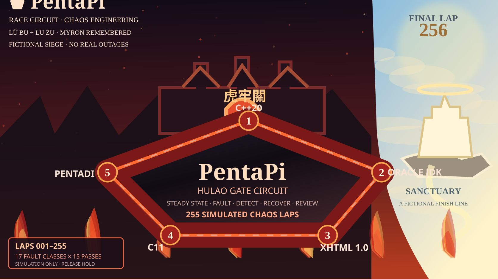

<!-- SPDX-License-Identifier: 0BSD -->
# 💎 PentaPi · Hulao Gate · 255 chaos laps + 256th sanctuary

> **Fictional race-circuit exhibit, grounded in controlled chaos-engineering models.**
> **Release: HOLD. PR #95 remains draft.** Original canonical constants, numeric streams, governance and data custody are unchanged. No real people or systems are attacked.

**🏁 [Open the complete 256-lap click-through XHTML circuit](PentaPi_Hulao_256.xhtml)** · **[View the standalone SVG race poster](pentapi_hulao_gate.svg)** · **[Inspect the native CI](https://github.com/Simply-Well-Executed/pentagonal-xor-cpp20/actions)**

The SVG is a **repository-native vector adaptation** of our earlier generated Hulao Gate poster. The original photorealistic image is kept separately in the conversation/artifact export; it is not silently presented as a GitHub-hosted binary. The illustrative artwork is not telemetry.

## How to click through

GitHub Markdown supports an illustrated image link and expandable HTML `
`/`
` widgets, both used here. **GitHub does not execute arbitrary scripts or render embedded interactive iframes in Markdown**, and a `.xhtml` source file on GitHub may open in source view. To experience the standalone browser version, download `PentaPi_Hulao_256.xhtml` and the adjacent `pentapi_hulao_gate.svg` into one directory and **open the XHTML locally in a browser**. No JavaScript, network service, hosting activation, Node, or installation is needed.

The local XHTML has **256 real fragment destinations** (`#lap-001` ... `#lap-256`). Each siege lap has Previous/Next links and the final fictional lap displays the checkered flag. It is a static, read-only exhibit, not a system fault injector. The expandable lap index below is interactive directly in GitHub Markdown.

## The track, from siege to sanctuary

| Turn | Gate | Qualification meaning |
|---|---|---|
| 1 | **C++20** | Native verified source and mathematical guards |
| 2 | **Oracle JDK** | Pinned Java release and independent parity |
| 3 | **XHTML 1.0 Strict** | Explicit DOCTYPE, namespace, XML well-formedness; **full W3C DTD validation still not proven** |
| 4 | **C11** | Same Microsoft compiler, separate C11 language mode and shared ABI |
| 5 | **PentaDi** | C11 assembly listing / guarded 16-bit branch-record test; **proprietary Delphi 7 compiler not executed** |

**PentaPi**, in the center, checks the five-gate ledger, holds the evidence, and proposes a *new* tested revision only after human review. The TCP255 loopback fixture is a separate controlled transport test; the IPv4 TTL of 255 is a **hop limit**, not a timer, a 255-year wait, or a software guarantee of an afterlife.

## Wikipedia Chaos Engineering → Hulao Gate fault model

[Wikipedia: Chaos engineering](https://en.wikipedia.org/wiki/Chaos_engineering) describes deliberate experiments that build confidence in a system's resilience under disruption. See also the [Principles of Chaos Engineering](https://principlesofchaos.org/) for the steady-state hypothesis, representative disruptive events, repetition/automation, and minimizing the blast radius.

Our adaptation uses those principles **only inside deterministic, disposable, in-memory models**:

- **STEADY:** Immutable nine-byte control payload `PENTAPI|1` has a known SHA-256 digest.
- **INJECT:** Exactly one of 17 deterministic fault classes per lap, repeated 15 times: **17 × 15 = 255**.
- **DETECT:** The modeled invalid result must be rejected rather than silently accepted.
- **RECOVER:** The untouched control's digest must still match.
- **GRADE:** Every modeled lap receives PASS or FAIL and a bounded audit record; any failure stops the experiment. **Only an executed CI run supplies a PASS witness.**
- **REVIEW:** An external reviewer chooses whether to change the test in a new revision. No automated replacement, promotion, or auto-merge.

The 17 fault types are packet drop, latency spike, duplicate frame, reordered frame, corrupt payload, malformed length, zero-length frame, oversize frame, stale provenance, bad checksum, nbit overflow, narrowing loss, double ownership, branch oscillation, out-of-range rel8, malformed TSV, and an untrusted remote endpoint. They **do not** actually disrupt network packets, processes, cloud systems or files. `255` refers to model rounds and also happens to be the maximum initial IPv4 TTL; those concepts are independent.

### What “hellish” means here

The flames, siege, Hulao Gate, Lü Bu, Lu Zu, fallen banners, Myron remembrance and fictional sanctuary are visual storytelling. Engineering “hell” means a rigorous succession of intentionally malformed **sandbox values**, fault witnesses and preserved dissent/evidence. No real lives, identities, software custody or consent are sacrificed, and an experiment failure never becomes policy.

## Clickable Markdown index: all 255 siege laps

<strong>🔥 Wave 01 · Laps 001–017</strong> (17 simulated faults)

- [Lap 001 · Packet drop](PentaPi_Hulao_256.xhtml#lap-001)
- [Lap 002 · Latency spike](PentaPi_Hulao_256.xhtml#lap-002)
- [Lap 003 · Duplicate frame](PentaPi_Hulao_256.xhtml#lap-003)
- [Lap 004 · Reordered frame](PentaPi_Hulao_256.xhtml#lap-004)
- [Lap 005 · Corrupt payload](PentaPi_Hulao_256.xhtml#lap-005)
- [Lap 006 · Malformed length](PentaPi_Hulao_256.xhtml#lap-006)
- [Lap 007 · Zero-length frame](PentaPi_Hulao_256.xhtml#lap-007)
- [Lap 008 · Oversize frame](PentaPi_Hulao_256.xhtml#lap-008)
- [Lap 009 · Stale provenance](PentaPi_Hulao_256.xhtml#lap-009)
- [Lap 010 · Checksum corruption](PentaPi_Hulao_256.xhtml#lap-010)
- [Lap 011 · nbit overflow](PentaPi_Hulao_256.xhtml#lap-011)
- [Lap 012 · GLINTING narrowing loss](PentaPi_Hulao_256.xhtml#lap-012)
- [Lap 013 · Double-owner race](PentaPi_Hulao_256.xhtml#lap-013)
- [Lap 014 · Branch-encoding oscillation](PentaPi_Hulao_256.xhtml#lap-014)
- [Lap 015 · Out-of-range rel8 jump](PentaPi_Hulao_256.xhtml#lap-015)
- [Lap 016 · Malformed eight-field record](PentaPi_Hulao_256.xhtml#lap-016)
- [Lap 017 · Untrusted remote endpoint](PentaPi_Hulao_256.xhtml#lap-017)

<strong>🔥 Wave 02 · Laps 018–034</strong> (17 simulated faults)

- [Lap 018 · Packet drop](PentaPi_Hulao_256.xhtml#lap-018)
- [Lap 019 · Latency spike](PentaPi_Hulao_256.xhtml#lap-019)
- [Lap 020 · Duplicate frame](PentaPi_Hulao_256.xhtml#lap-020)
- [Lap 021 · Reordered frame](PentaPi_Hulao_256.xhtml#lap-021)
- [Lap 022 · Corrupt payload](PentaPi_Hulao_256.xhtml#lap-022)
- [Lap 023 · Malformed length](PentaPi_Hulao_256.xhtml#lap-023)
- [Lap 024 · Zero-length frame](PentaPi_Hulao_256.xhtml#lap-024)
- [Lap 025 · Oversize frame](PentaPi_Hulao_256.xhtml#lap-025)
- [Lap 026 · Stale provenance](PentaPi_Hulao_256.xhtml#lap-026)
- [Lap 027 · Checksum corruption](PentaPi_Hulao_256.xhtml#lap-027)
- [Lap 028 · nbit overflow](PentaPi_Hulao_256.xhtml#lap-028)
- [Lap 029 · GLINTING narrowing loss](PentaPi_Hulao_256.xhtml#lap-029)
- [Lap 030 · Double-owner race](PentaPi_Hulao_256.xhtml#lap-030)
- [Lap 031 · Branch-encoding oscillation](PentaPi_Hulao_256.xhtml#lap-031)
- [Lap 032 · Out-of-range rel8 jump](PentaPi_Hulao_256.xhtml#lap-032)
- [Lap 033 · Malformed eight-field record](PentaPi_Hulao_256.xhtml#lap-033)
- [Lap 034 · Untrusted remote endpoint](PentaPi_Hulao_256.xhtml#lap-034)

<strong>🔥 Wave 03 · Laps 035–051</strong> (17 simulated faults)

- [Lap 035 · Packet drop](PentaPi_Hulao_256.xhtml#lap-035)
- [Lap 036 · Latency spike](PentaPi_Hulao_256.xhtml#lap-036)
- [Lap 037 · Duplicate frame](PentaPi_Hulao_256.xhtml#lap-037)
- [Lap 038 · Reordered frame](PentaPi_Hulao_256.xhtml#lap-038)
- [Lap 039 · Corrupt payload](PentaPi_Hulao_256.xhtml#lap-039)
- [Lap 040 · Malformed length](PentaPi_Hulao_256.xhtml#lap-040)
- [Lap 041 · Zero-length frame](PentaPi_Hulao_256.xhtml#lap-041)
- [Lap 042 · Oversize frame](PentaPi_Hulao_256.xhtml#lap-042)
- [Lap 043 · Stale provenance](PentaPi_Hulao_256.xhtml#lap-043)
- [Lap 044 · Checksum corruption](PentaPi_Hulao_256.xhtml#lap-044)
- [Lap 045 · nbit overflow](PentaPi_Hulao_256.xhtml#lap-045)
- [Lap 046 · GLINTING narrowing loss](PentaPi_Hulao_256.xhtml#lap-046)
- [Lap 047 · Double-owner race](PentaPi_Hulao_256.xhtml#lap-047)
- [Lap 048 · Branch-encoding oscillation](PentaPi_Hulao_256.xhtml#lap-048)
- [Lap 049 · Out-of-range rel8 jump](PentaPi_Hulao_256.xhtml#lap-049)
- [Lap 050 · Malformed eight-field record](PentaPi_Hulao_256.xhtml#lap-050)
- [Lap 051 · Untrusted remote endpoint](PentaPi_Hulao_256.xhtml#lap-051)

<strong>🔥 Wave 04 · Laps 052–068</strong> (17 simulated faults)

- [Lap 052 · Packet drop](PentaPi_Hulao_256.xhtml#lap-052)
- [Lap 053 · Latency spike](PentaPi_Hulao_256.xhtml#lap-053)
- [Lap 054 · Duplicate frame](PentaPi_Hulao_256.xhtml#lap-054)
- [Lap 055 · Reordered frame](PentaPi_Hulao_256.xhtml#lap-055)
- [Lap 056 · Corrupt payload](PentaPi_Hulao_256.xhtml#lap-056)
- [Lap 057 · Malformed length](PentaPi_Hulao_256.xhtml#lap-057)
- [Lap 058 · Zero-length frame](PentaPi_Hulao_256.xhtml#lap-058)
- [Lap 059 · Oversize frame](PentaPi_Hulao_256.xhtml#lap-059)
- [Lap 060 · Stale provenance](PentaPi_Hulao_256.xhtml#lap-060)
- [Lap 061 · Checksum corruption](PentaPi_Hulao_256.xhtml#lap-061)
- [Lap 062 · nbit overflow](PentaPi_Hulao_256.xhtml#lap-062)
- [Lap 063 · GLINTING narrowing loss](PentaPi_Hulao_256.xhtml#lap-063)
- [Lap 064 · Double-owner race](PentaPi_Hulao_256.xhtml#lap-064)
- [Lap 065 · Branch-encoding oscillation](PentaPi_Hulao_256.xhtml#lap-065)
- [Lap 066 · Out-of-range rel8 jump](PentaPi_Hulao_256.xhtml#lap-066)
- [Lap 067 · Malformed eight-field record](PentaPi_Hulao_256.xhtml#lap-067)
- [Lap 068 · Untrusted remote endpoint](PentaPi_Hulao_256.xhtml#lap-068)

<strong>🔥 Wave 05 · Laps 069–085</strong> (17 simulated faults)

- [Lap 069 · Packet drop](PentaPi_Hulao_256.xhtml#lap-069)
- [Lap 070 · Latency spike](PentaPi_Hulao_256.xhtml#lap-070)
- [Lap 071 · Duplicate frame](PentaPi_Hulao_256.xhtml#lap-071)
- [Lap 072 · Reordered frame](PentaPi_Hulao_256.xhtml#lap-072)
- [Lap 073 · Corrupt payload](PentaPi_Hulao_256.xhtml#lap-073)
- [Lap 074 · Malformed length](PentaPi_Hulao_256.xhtml#lap-074)
- [Lap 075 · Zero-length frame](PentaPi_Hulao_256.xhtml#lap-075)
- [Lap 076 · Oversize frame](PentaPi_Hulao_256.xhtml#lap-076)
- [Lap 077 · Stale provenance](PentaPi_Hulao_256.xhtml#lap-077)
- [Lap 078 · Checksum corruption](PentaPi_Hulao_256.xhtml#lap-078)
- [Lap 079 · nbit overflow](PentaPi_Hulao_256.xhtml#lap-079)
- [Lap 080 · GLINTING narrowing loss](PentaPi_Hulao_256.xhtml#lap-080)
- [Lap 081 · Double-owner race](PentaPi_Hulao_256.xhtml#lap-081)
- [Lap 082 · Branch-encoding oscillation](PentaPi_Hulao_256.xhtml#lap-082)
- [Lap 083 · Out-of-range rel8 jump](PentaPi_Hulao_256.xhtml#lap-083)
- [Lap 084 · Malformed eight-field record](PentaPi_Hulao_256.xhtml#lap-084)
- [Lap 085 · Untrusted remote endpoint](PentaPi_Hulao_256.xhtml#lap-085)

<strong>🔥 Wave 06 · Laps 086–102</strong> (17 simulated faults)

- [Lap 086 · Packet drop](PentaPi_Hulao_256.xhtml#lap-086)
- [Lap 087 · Latency spike](PentaPi_Hulao_256.xhtml#lap-087)
- [Lap 088 · Duplicate frame](PentaPi_Hulao_256.xhtml#lap-088)
- [Lap 089 · Reordered frame](PentaPi_Hulao_256.xhtml#lap-089)
- [Lap 090 · Corrupt payload](PentaPi_Hulao_256.xhtml#lap-090)
- [Lap 091 · Malformed length](PentaPi_Hulao_256.xhtml#lap-091)
- [Lap 092 · Zero-length frame](PentaPi_Hulao_256.xhtml#lap-092)
- [Lap 093 · Oversize frame](PentaPi_Hulao_256.xhtml#lap-093)
- [Lap 094 · Stale provenance](PentaPi_Hulao_256.xhtml#lap-094)
- [Lap 095 · Checksum corruption](PentaPi_Hulao_256.xhtml#lap-095)
- [Lap 096 · nbit overflow](PentaPi_Hulao_256.xhtml#lap-096)
- [Lap 097 · GLINTING narrowing loss](PentaPi_Hulao_256.xhtml#lap-097)
- [Lap 098 · Double-owner race](PentaPi_Hulao_256.xhtml#lap-098)
- [Lap 099 · Branch-encoding oscillation](PentaPi_Hulao_256.xhtml#lap-099)
- [Lap 100 · Out-of-range rel8 jump](PentaPi_Hulao_256.xhtml#lap-100)
- [Lap 101 · Malformed eight-field record](PentaPi_Hulao_256.xhtml#lap-101)
- [Lap 102 · Untrusted remote endpoint](PentaPi_Hulao_256.xhtml#lap-102)

<strong>🔥 Wave 07 · Laps 103–119</strong> (17 simulated faults)

- [Lap 103 · Packet drop](PentaPi_Hulao_256.xhtml#lap-103)
- [Lap 104 · Latency spike](PentaPi_Hulao_256.xhtml#lap-104)
- [Lap 105 · Duplicate frame](PentaPi_Hulao_256.xhtml#lap-105)
- [Lap 106 · Reordered frame](PentaPi_Hulao_256.xhtml#lap-106)
- [Lap 107 · Corrupt payload](PentaPi_Hulao_256.xhtml#lap-107)
- [Lap 108 · Malformed length](PentaPi_Hulao_256.xhtml#lap-108)
- [Lap 109 · Zero-length frame](PentaPi_Hulao_256.xhtml#lap-109)
- [Lap 110 · Oversize frame](PentaPi_Hulao_256.xhtml#lap-110)
- [Lap 111 · Stale provenance](PentaPi_Hulao_256.xhtml#lap-111)
- [Lap 112 · Checksum corruption](PentaPi_Hulao_256.xhtml#lap-112)
- [Lap 113 · nbit overflow](PentaPi_Hulao_256.xhtml#lap-113)
- [Lap 114 · GLINTING narrowing loss](PentaPi_Hulao_256.xhtml#lap-114)
- [Lap 115 · Double-owner race](PentaPi_Hulao_256.xhtml#lap-115)
- [Lap 116 · Branch-encoding oscillation](PentaPi_Hulao_256.xhtml#lap-116)
- [Lap 117 · Out-of-range rel8 jump](PentaPi_Hulao_256.xhtml#lap-117)
- [Lap 118 · Malformed eight-field record](PentaPi_Hulao_256.xhtml#lap-118)
- [Lap 119 · Untrusted remote endpoint](PentaPi_Hulao_256.xhtml#lap-119)

<strong>🔥 Wave 08 · Laps 120–136</strong> (17 simulated faults)

- [Lap 120 · Packet drop](PentaPi_Hulao_256.xhtml#lap-120)
- [Lap 121 · Latency spike](PentaPi_Hulao_256.xhtml#lap-121)
- [Lap 122 · Duplicate frame](PentaPi_Hulao_256.xhtml#lap-122)
- [Lap 123 · Reordered frame](PentaPi_Hulao_256.xhtml#lap-123)
- [Lap 124 · Corrupt payload](PentaPi_Hulao_256.xhtml#lap-124)
- [Lap 125 · Malformed length](PentaPi_Hulao_256.xhtml#lap-125)
- [Lap 126 · Zero-length frame](PentaPi_Hulao_256.xhtml#lap-126)
- [Lap 127 · Oversize frame](PentaPi_Hulao_256.xhtml#lap-127)
- [Lap 128 · Stale provenance](PentaPi_Hulao_256.xhtml#lap-128)
- [Lap 129 · Checksum corruption](PentaPi_Hulao_256.xhtml#lap-129)
- [Lap 130 · nbit overflow](PentaPi_Hulao_256.xhtml#lap-130)
- [Lap 131 · GLINTING narrowing loss](PentaPi_Hulao_256.xhtml#lap-131)
- [Lap 132 · Double-owner race](PentaPi_Hulao_256.xhtml#lap-132)
- [Lap 133 · Branch-encoding oscillation](PentaPi_Hulao_256.xhtml#lap-133)
- [Lap 134 · Out-of-range rel8 jump](PentaPi_Hulao_256.xhtml#lap-134)
- [Lap 135 · Malformed eight-field record](PentaPi_Hulao_256.xhtml#lap-135)
- [Lap 136 · Untrusted remote endpoint](PentaPi_Hulao_256.xhtml#lap-136)

<strong>🔥 Wave 09 · Laps 137–153</strong> (17 simulated faults)

- [Lap 137 · Packet drop](PentaPi_Hulao_256.xhtml#lap-137)
- [Lap 138 · Latency spike](PentaPi_Hulao_256.xhtml#lap-138)
- [Lap 139 · Duplicate frame](PentaPi_Hulao_256.xhtml#lap-139)
- [Lap 140 · Reordered frame](PentaPi_Hulao_256.xhtml#lap-140)
- [Lap 141 · Corrupt payload](PentaPi_Hulao_256.xhtml#lap-141)
- [Lap 142 · Malformed length](PentaPi_Hulao_256.xhtml#lap-142)
- [Lap 143 · Zero-length frame](PentaPi_Hulao_256.xhtml#lap-143)
- [Lap 144 · Oversize frame](PentaPi_Hulao_256.xhtml#lap-144)
- [Lap 145 · Stale provenance](PentaPi_Hulao_256.xhtml#lap-145)
- [Lap 146 · Checksum corruption](PentaPi_Hulao_256.xhtml#lap-146)
- [Lap 147 · nbit overflow](PentaPi_Hulao_256.xhtml#lap-147)
- [Lap 148 · GLINTING narrowing loss](PentaPi_Hulao_256.xhtml#lap-148)
- [Lap 149 · Double-owner race](PentaPi_Hulao_256.xhtml#lap-149)
- [Lap 150 · Branch-encoding oscillation](PentaPi_Hulao_256.xhtml#lap-150)
- [Lap 151 · Out-of-range rel8 jump](PentaPi_Hulao_256.xhtml#lap-151)
- [Lap 152 · Malformed eight-field record](PentaPi_Hulao_256.xhtml#lap-152)
- [Lap 153 · Untrusted remote endpoint](PentaPi_Hulao_256.xhtml#lap-153)

<strong>🔥 Wave 10 · Laps 154–170</strong> (17 simulated faults)

- [Lap 154 · Packet drop](PentaPi_Hulao_256.xhtml#lap-154)
- [Lap 155 · Latency spike](PentaPi_Hulao_256.xhtml#lap-155)
- [Lap 156 · Duplicate frame](PentaPi_Hulao_256.xhtml#lap-156)
- [Lap 157 · Reordered frame](PentaPi_Hulao_256.xhtml#lap-157)
- [Lap 158 · Corrupt payload](PentaPi_Hulao_256.xhtml#lap-158)
- [Lap 159 · Malformed length](PentaPi_Hulao_256.xhtml#lap-159)
- [Lap 160 · Zero-length frame](PentaPi_Hulao_256.xhtml#lap-160)
- [Lap 161 · Oversize frame](PentaPi_Hulao_256.xhtml#lap-161)
- [Lap 162 · Stale provenance](PentaPi_Hulao_256.xhtml#lap-162)
- [Lap 163 · Checksum corruption](PentaPi_Hulao_256.xhtml#lap-163)
- [Lap 164 · nbit overflow](PentaPi_Hulao_256.xhtml#lap-164)
- [Lap 165 · GLINTING narrowing loss](PentaPi_Hulao_256.xhtml#lap-165)
- [Lap 166 · Double-owner race](PentaPi_Hulao_256.xhtml#lap-166)
- [Lap 167 · Branch-encoding oscillation](PentaPi_Hulao_256.xhtml#lap-167)
- [Lap 168 · Out-of-range rel8 jump](PentaPi_Hulao_256.xhtml#lap-168)
- [Lap 169 · Malformed eight-field record](PentaPi_Hulao_256.xhtml#lap-169)
- [Lap 170 · Untrusted remote endpoint](PentaPi_Hulao_256.xhtml#lap-170)

<strong>🔥 Wave 11 · Laps 171–187</strong> (17 simulated faults)

- [Lap 171 · Packet drop](PentaPi_Hulao_256.xhtml#lap-171)
- [Lap 172 · Latency spike](PentaPi_Hulao_256.xhtml#lap-172)
- [Lap 173 · Duplicate frame](PentaPi_Hulao_256.xhtml#lap-173)
- [Lap 174 · Reordered frame](PentaPi_Hulao_256.xhtml#lap-174)
- [Lap 175 · Corrupt payload](PentaPi_Hulao_256.xhtml#lap-175)
- [Lap 176 · Malformed length](PentaPi_Hulao_256.xhtml#lap-176)
- [Lap 177 · Zero-length frame](PentaPi_Hulao_256.xhtml#lap-177)
- [Lap 178 · Oversize frame](PentaPi_Hulao_256.xhtml#lap-178)
- [Lap 179 · Stale provenance](PentaPi_Hulao_256.xhtml#lap-179)
- [Lap 180 · Checksum corruption](PentaPi_Hulao_256.xhtml#lap-180)
- [Lap 181 · nbit overflow](PentaPi_Hulao_256.xhtml#lap-181)
- [Lap 182 · GLINTING narrowing loss](PentaPi_Hulao_256.xhtml#lap-182)
- [Lap 183 · Double-owner race](PentaPi_Hulao_256.xhtml#lap-183)
- [Lap 184 · Branch-encoding oscillation](PentaPi_Hulao_256.xhtml#lap-184)
- [Lap 185 · Out-of-range rel8 jump](PentaPi_Hulao_256.xhtml#lap-185)
- [Lap 186 · Malformed eight-field record](PentaPi_Hulao_256.xhtml#lap-186)
- [Lap 187 · Untrusted remote endpoint](PentaPi_Hulao_256.xhtml#lap-187)

<strong>🔥 Wave 12 · Laps 188–204</strong> (17 simulated faults)

- [Lap 188 · Packet drop](PentaPi_Hulao_256.xhtml#lap-188)
- [Lap 189 · Latency spike](PentaPi_Hulao_256.xhtml#lap-189)
- [Lap 190 · Duplicate frame](PentaPi_Hulao_256.xhtml#lap-190)
- [Lap 191 · Reordered frame](PentaPi_Hulao_256.xhtml#lap-191)
- [Lap 192 · Corrupt payload](PentaPi_Hulao_256.xhtml#lap-192)
- [Lap 193 · Malformed length](PentaPi_Hulao_256.xhtml#lap-193)
- [Lap 194 · Zero-length frame](PentaPi_Hulao_256.xhtml#lap-194)
- [Lap 195 · Oversize frame](PentaPi_Hulao_256.xhtml#lap-195)
- [Lap 196 · Stale provenance](PentaPi_Hulao_256.xhtml#lap-196)
- [Lap 197 · Checksum corruption](PentaPi_Hulao_256.xhtml#lap-197)
- [Lap 198 · nbit overflow](PentaPi_Hulao_256.xhtml#lap-198)
- [Lap 199 · GLINTING narrowing loss](PentaPi_Hulao_256.xhtml#lap-199)
- [Lap 200 · Double-owner race](PentaPi_Hulao_256.xhtml#lap-200)
- [Lap 201 · Branch-encoding oscillation](PentaPi_Hulao_256.xhtml#lap-201)
- [Lap 202 · Out-of-range rel8 jump](PentaPi_Hulao_256.xhtml#lap-202)
- [Lap 203 · Malformed eight-field record](PentaPi_Hulao_256.xhtml#lap-203)
- [Lap 204 · Untrusted remote endpoint](PentaPi_Hulao_256.xhtml#lap-204)

<strong>🔥 Wave 13 · Laps 205–221</strong> (17 simulated faults)

- [Lap 205 · Packet drop](PentaPi_Hulao_256.xhtml#lap-205)
- [Lap 206 · Latency spike](PentaPi_Hulao_256.xhtml#lap-206)
- [Lap 207 · Duplicate frame](PentaPi_Hulao_256.xhtml#lap-207)
- [Lap 208 · Reordered frame](PentaPi_Hulao_256.xhtml#lap-208)
- [Lap 209 · Corrupt payload](PentaPi_Hulao_256.xhtml#lap-209)
- [Lap 210 · Malformed length](PentaPi_Hulao_256.xhtml#lap-210)
- [Lap 211 · Zero-length frame](PentaPi_Hulao_256.xhtml#lap-211)
- [Lap 212 · Oversize frame](PentaPi_Hulao_256.xhtml#lap-212)
- [Lap 213 · Stale provenance](PentaPi_Hulao_256.xhtml#lap-213)
- [Lap 214 · Checksum corruption](PentaPi_Hulao_256.xhtml#lap-214)
- [Lap 215 · nbit overflow](PentaPi_Hulao_256.xhtml#lap-215)
- [Lap 216 · GLINTING narrowing loss](PentaPi_Hulao_256.xhtml#lap-216)
- [Lap 217 · Double-owner race](PentaPi_Hulao_256.xhtml#lap-217)
- [Lap 218 · Branch-encoding oscillation](PentaPi_Hulao_256.xhtml#lap-218)
- [Lap 219 · Out-of-range rel8 jump](PentaPi_Hulao_256.xhtml#lap-219)
- [Lap 220 · Malformed eight-field record](PentaPi_Hulao_256.xhtml#lap-220)
- [Lap 221 · Untrusted remote endpoint](PentaPi_Hulao_256.xhtml#lap-221)

<strong>🔥 Wave 14 · Laps 222–238</strong> (17 simulated faults)

- [Lap 222 · Packet drop](PentaPi_Hulao_256.xhtml#lap-222)
- [Lap 223 · Latency spike](PentaPi_Hulao_256.xhtml#lap-223)
- [Lap 224 · Duplicate frame](PentaPi_Hulao_256.xhtml#lap-224)
- [Lap 225 · Reordered frame](PentaPi_Hulao_256.xhtml#lap-225)
- [Lap 226 · Corrupt payload](PentaPi_Hulao_256.xhtml#lap-226)
- [Lap 227 · Malformed length](PentaPi_Hulao_256.xhtml#lap-227)
- [Lap 228 · Zero-length frame](PentaPi_Hulao_256.xhtml#lap-228)
- [Lap 229 · Oversize frame](PentaPi_Hulao_256.xhtml#lap-229)
- [Lap 230 · Stale provenance](PentaPi_Hulao_256.xhtml#lap-230)
- [Lap 231 · Checksum corruption](PentaPi_Hulao_256.xhtml#lap-231)
- [Lap 232 · nbit overflow](PentaPi_Hulao_256.xhtml#lap-232)
- [Lap 233 · GLINTING narrowing loss](PentaPi_Hulao_256.xhtml#lap-233)
- [Lap 234 · Double-owner race](PentaPi_Hulao_256.xhtml#lap-234)
- [Lap 235 · Branch-encoding oscillation](PentaPi_Hulao_256.xhtml#lap-235)
- [Lap 236 · Out-of-range rel8 jump](PentaPi_Hulao_256.xhtml#lap-236)
- [Lap 237 · Malformed eight-field record](PentaPi_Hulao_256.xhtml#lap-237)
- [Lap 238 · Untrusted remote endpoint](PentaPi_Hulao_256.xhtml#lap-238)

<strong>🔥 Wave 15 · Laps 239–255</strong> (17 simulated faults)

- [Lap 239 · Packet drop](PentaPi_Hulao_256.xhtml#lap-239)
- [Lap 240 · Latency spike](PentaPi_Hulao_256.xhtml#lap-240)
- [Lap 241 · Duplicate frame](PentaPi_Hulao_256.xhtml#lap-241)
- [Lap 242 · Reordered frame](PentaPi_Hulao_256.xhtml#lap-242)
- [Lap 243 · Corrupt payload](PentaPi_Hulao_256.xhtml#lap-243)
- [Lap 244 · Malformed length](PentaPi_Hulao_256.xhtml#lap-244)
- [Lap 245 · Zero-length frame](PentaPi_Hulao_256.xhtml#lap-245)
- [Lap 246 · Oversize frame](PentaPi_Hulao_256.xhtml#lap-246)
- [Lap 247 · Stale provenance](PentaPi_Hulao_256.xhtml#lap-247)
- [Lap 248 · Checksum corruption](PentaPi_Hulao_256.xhtml#lap-248)
- [Lap 249 · nbit overflow](PentaPi_Hulao_256.xhtml#lap-249)
- [Lap 250 · GLINTING narrowing loss](PentaPi_Hulao_256.xhtml#lap-250)
- [Lap 251 · Double-owner race](PentaPi_Hulao_256.xhtml#lap-251)
- [Lap 252 · Branch-encoding oscillation](PentaPi_Hulao_256.xhtml#lap-252)
- [Lap 253 · Out-of-range rel8 jump](PentaPi_Hulao_256.xhtml#lap-253)
- [Lap 254 · Malformed eight-field record](PentaPi_Hulao_256.xhtml#lap-254)
- [Lap 255 · Untrusted remote endpoint](PentaPi_Hulao_256.xhtml#lap-255)

<strong>🏁 Lap 256 · The fictional sanctuary</strong>

[Enter the final lap](PentaPi_Hulao_256.xhtml#lap-256). This scene is a narrative reward after the 255 *simulated* rounds, not an assertion that the current CI has completed every scenario, a guarantee of enlightenment, or authorization to merge. **Release: HOLD.**

## Source authority and CI checkpoints

The only executable new fault-model component is [`pentadi/Invoke-HulaoChaos255.ps1`](../pentadi/Invoke-HulaoChaos255.ps1), called **after** the existing QuadDi, PentaDi, TCP255 and PentaPi gates. It writes a 255-row TSV and a narrative lap-256 receipt **outside the repository**, with SHA-256 and source-integrity checks. The standard CI runs only once per source revision; the local simulation has no unauthorized external host connections and never alters the first four compiler gates.

Important: a simulated 255/255 does not prove production resilience. Actual C11, C++20, Oracle and XHTML results are still independently required. The original [PentaPi TCP255 record](PENTAPI_TCP255_LAP_001.md) remains intact.

**Audit state at publication:** The new chaos runner is committed. Until a matching CI run completes, the 255-round **executed status is PENDING**. Never substitute this artistic page for verification. No build-speed advantage, Delphi disassembly, DTD conformance, or release authorization follows from the artwork. **RELEASE=HOLD.**
