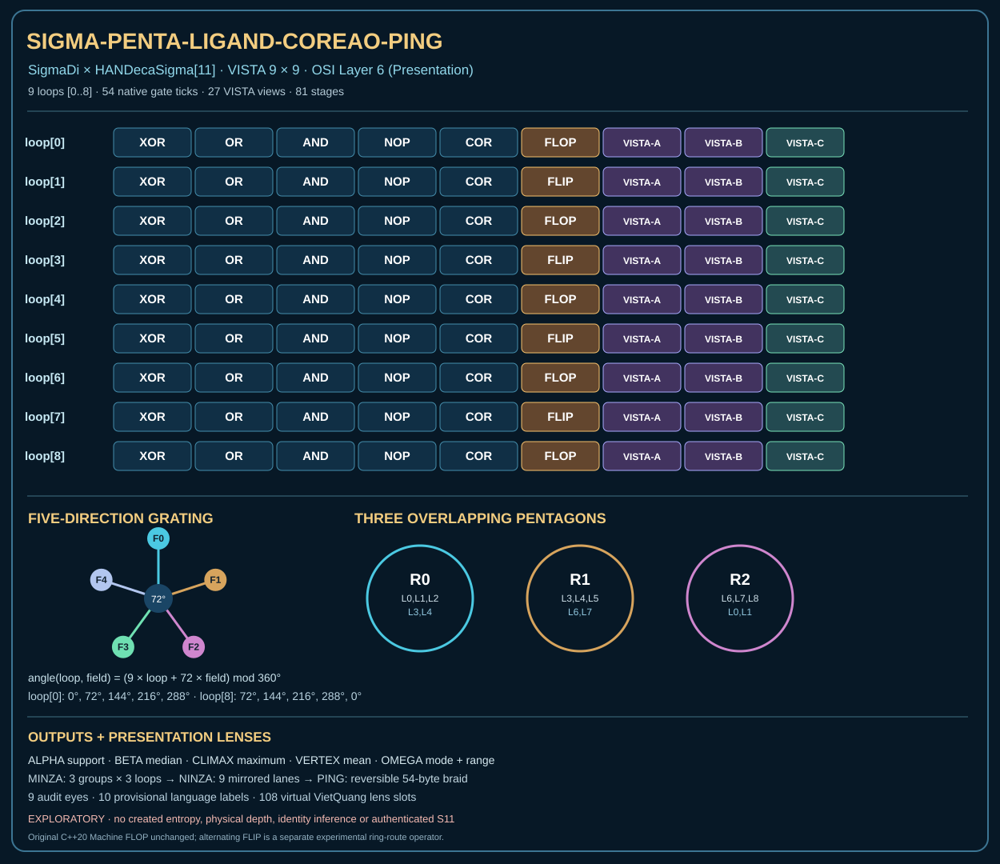

# SIGMA-PENTA-LIGAND-COREAO-PING × SigmaDi × HANDecaSigma[11]

> **Document status: DUE FOR UPDATE (2026-11-19).** Verify claims against code and tests; sharpen active verbs; check copyright, project-mark language, accessibility, and 0BSD scope. This mark is not a failure verdict. See [DOCUMENT_REVIEW_REGISTER.md](DOCUMENT_REVIEW_REGISTER.md) and [LICENSE_AND_MARKS.md](LICENSE_AND_MARKS.md).
>
> **Original contributions:** Copyright (c) 2026 Paul Allen Cheek · SPDX-License-Identifier: 0BSD. Third-party material and marks retain their respective rights; no registered mark is asserted.


**Status: EXPLORATORY, 0BSD, zero-based, OSI layer 6 (Presentation).**
Authority: `shared/sigma_penta_ping.hpp` and
`shared/sigmadi_handecasigma_presentation.hpp`. The original
Pentagonal parity and `Machine` remain unmodified.



## Correcting the five-line grating

The former visual plate incorrectly displayed five parallel scan lines.
Here the five **directed** scanning angles are independently
rendered and spaced around the pentagon:

```text
angle(loop, field) = (9 × loop + 72 × field) mod 360°
loop indices: 0..8; field indices: F0..F4
loop[0] = [0°, 72°, 144°, 216°, 288°]
loop[1] = [9°, 81°, 153°, 225°, 297°]
loop[8] = [72°, 144°, 216°, 288°, 0°]
```

Exactly five directed directions can have circular nearest-neighbor
separations >=72° only when all separations are exactly 72°.
The 9° phase advance is a protocol-specific repeatable probe, not
cryptographic randomness and not evidence of adversarial tampering.

The source images must be individually and carefully registered;
applying a direction to a sampling *line* does not rotate the original
pixels, and a presentation ray does not recover uncaptured details.
The new C++20 header operates on caller-supplied 5-byte **samples**,
not PNG files. The earlier badge-image rendering is not asserted
to have been re-run through this header.

## Five output views

For five raw unsigned 8-bit input intensities per sampling position:

| Output | Exact definition | Ambiguity |
|---|---|---|
| ALPHA | Number of fields >= threshold, scaled by 51 to 0..255 | **Support mask**, not transparency estimated by a model |
| BETA | Sorted value[2] from five samples | **Median** |
| CLIMAX | Maximum of five samples | **MAX** |
| VERTEX | Arithmetic sum / 5 as a double | **MEAN**, never median |
| OMEGA | Minimum-tie-broken mode; maximum minus minimum | Paired **MODE/RANGE** with tie and count retained |

Every ring uses **nine deliberately declared normalized features**:
F0/255, F1/255, F2/255, F3/255, F4/255,
MIN/255, MAX/255, MEAN/255, RANGE/255.
These are *derived and correlated*, not nine independent measurements.
The original `stability10d.hpp` parity kernel computes these
three canonical overlapping rings, without reimplementing parity:

```text
ring[0] = (L0,L1,L2,L3,L4)
ring[1] = (L3,L4,L5,L6,L7)
ring[2] = (L6,L7,L8,L0,L1)
```

## MINZA → NINZA → PING

`MINZA[0]` holds loops [0,1,2]; `MINZA[1]` holds [3,4,5];
`MINZA[2]` holds [6,7,8]. Each loop has its three overlapping
five-ligand rings and six original output bytes (little-endian
ring words). Nine loop lanes produce 9 × 6 = 54 canonical-derived
bytes, with no renumbering.

`NINZA` preserves a *primary* and *mirrored* six-byte lane for each
of the nine loop indices. Both contain identical bytes at present.
They add **redundancy, zero new entropy, zero authentication, and no
claim of fault tolerance to simultaneous corruption**.

`PING` braids nine lanes by a deterministic column-dependent
permutation, reverses the permutation, and verifies byte-for-byte
roundtrip. It is not encryption, a cryptographic hash, compression,
physical string twisting, or an actual filesystem/RAID array.

The experimental terminal-route sequence on loop indices 0..8 is:

```text
FLOP, FLIP, FLOP, FLIP, FLOP, FLIP, FLOP, FLIP, FLOP
```

FLIP is a reversible **ring-route-direction toggle** in this
adapter. The original `Machine::tick` still ends each six-gate
controller cycle at FLOP, without modification. The three VISTA
read-only stages follow each completed native cycle; 54 native ticks
+ 27 VISTA reports = 81 logical stages. Altering the upstream FLOP
instruction itself would require a separately versioned protocol.

## OSI layer 6: SigmaDi × HANDecaSigma[11]

OSI **Layer 6** is Presentation, not Layer 7. The representation
transforms **only the displayed arrangement**, never the measured
source, boolean gates, original parity, COR bits, or provenance.

SigmaDi presents four display quadrants q0..q3 with initial polarities
[+,-,+,-]. An experimental FLIP twirl toggles the entire quadruple
as a smooth representational change. The previously proposed allowable
connections are q0↔q2, q0↔q1, q3↔q1 and q3↔q2.
There is no hidden routing/network authority implied by this picture.

The HANDecaSigma[11] user-source audit
`PROTOCOL.md` (2026-11-18), associated with
`handecasigma11_combined.jsonl`, defines:

```text
H11=(accepted_CW - accepted_CCW)/(accepted_CW + accepted_CCW)
divisor = 2 - abs(H11)       // when there are accepted turns
candidate S11 = S10 / divisor  // only if SAME-OBJECT canonical S10 exists
```

That source sampled image-change centroids at 15 and 30 fps; its
27 distinct videos include five chirality sign reversals and one
zero-to-positive discrepancy between rates. Therefore, H11 is a
sampling-sensitive visual-activity descriptor, **not** verified physical
rotation, biomechanics, or molecular-ligand stability.
The earlier video data have **no valid same-object S10/S11**:
both stay **null**, not zero. The C++20 presentation does not mix
video H11 evidence into static badge-image measurements, and it does
not manufacture a canonical S11 merely because a value was supplied.
If accepted turn counts are absent, H11 is also unavailable.

### Nine actual audit-eye roles

0 SHAPE, 1 BOUNDS, 2 STRUCTURE, 3 SCOPE/OWNERSHIP,
4 DOMAIN, 5 REDUCTION, 6 INVERSE, 7 COMPARISON,
8 PROVENANCE. These are nine **review prompts**:
they are *not* nine independent camera measurements.
The imaginative Hanzi 九眼 learning experiences are independent
language-learning artifacts, not historical character etymology
or optical evidence.

### Ten real-language display slots

The prototype offers a **provisional** UI list:
English `en`, French `fr`, Spanish `es`, Portuguese `pt`,
Italian `it`, Greek `el`, Russian `ru`, Ukrainian `uk`,
Korean `ko`, Vietnamese `vi`.
Ten languages are real. The prior record does **not** establish
an immutable exact list of ten designated "language eyes", so these
are configurable **presentation labels**, not invented prior CANON.
No actual multilingual translations are claimed by the C++20 API.

### VietQuang virtual inspection lenses

Each of the nine audit-eye categories can be presented through twelve
explicitly virtual render variations: 9 × 12 = **108 virtual slots**.
The display index runs 0..107. Virtual lenses have
`independent_evidence=false`, do not add entropy, and are not
108 Vietnamese dialects, verified witnesses, physical eyes or
newly tested feature extractors.

"300% empathy" is interpreted as a *design aspiration* for three
human-accessibility checks: preserve meaning, identify uncertainty,
and allow accessible presentation. This is not a measurable affect
score. `relativismos` has no verified formula in the source files;
its flag stays **undefined** and is not substituted by unrelated math.

## Audit and tests

`tests/sigma_penta_ping_test.cpp` checks:
- ALPHA, BETA, CLIMAX, VERTEX and OMEGA including mode ties.
- Each 72° circular separation and each 9° phase shift.
- Exactly five FLOPs alternating with four FLIPs.
- Zero-based MINZA 0..2, 54-byte NINZA/PING braid and inverse.
- Original five-field source preservation and 81-stage triple VISTA.

`tests/sigmadi_handecasigma_presentation_test.cpp` checks:
- Nine trace slots, ten display languages, 108 virtual slots.
- Four SigmaDi signs and terminal twirl state.
- Undefined H11 and S11 retained when source is missing.
- Defined H11 bounded divisor, no automatically asserted S11.

These tests require CMake/CTest CI; do not claim successful cross-platform
validation until corresponding completed checks are observed.

**Provenance:** source → measurement definition → VISTA/COR →
MINZA/NINZA/PING → OSI-6 display → audit. Retained records do not
authorize a correction or an identity inference. No mutation to
the source data is an invariant, not just a display choice.


## Dimension 12: declaration-collision provenance

The [SIGMADI-COLLISION-12D-v1 witness](SIGMADI_COLLISION12.md) adds
exactly twelve zero-based **metadata** coordinates D0..D11;
D11 records the declaration instance. The originating error was
a genuine duplicate `r` binding in the tool-side SVG builder.
It does not change H11 or imply a physical H12. The header
`shared/sigmadi_collision12.hpp` classifies distinct, duplicate,
scoped reuse, revised, and inconsistent declarations without
mutating the canonical data. The OSI-6 `View` exposes its axis
names read-only; it does not automatically parse source code.

## Cross-document terminal route check

**Compare** the existing `shared/sigma_penta_ping.hpp` terminal function
against [VISTA_9X9.md](VISTA_9X9.md). **Record** the five FLOPs and four
FLIPs separately from the nine native end-of-cycle FLOPs. **Verify**
that only route FLIPs toggle the reverse flag; the ninth loop returns
forward. **Preserve** the six-stage native gate schedule unchanged.

## New opt-in NINZA/PING inversion views

The [unforge/untwirl adapter](NINZA_PING_UNFORGE_UNTWIRL.md) preserves and compares NINZA's two six-byte copies per loop, then inverts PING's established column-dependent 54-byte braid. It provides source-index and destination-index provenance, retains every original lane, and generates no independent witness. The canonical producer remains unchanged. Review status stays **DUE FOR UPDATE** pending source and viewer verification.
