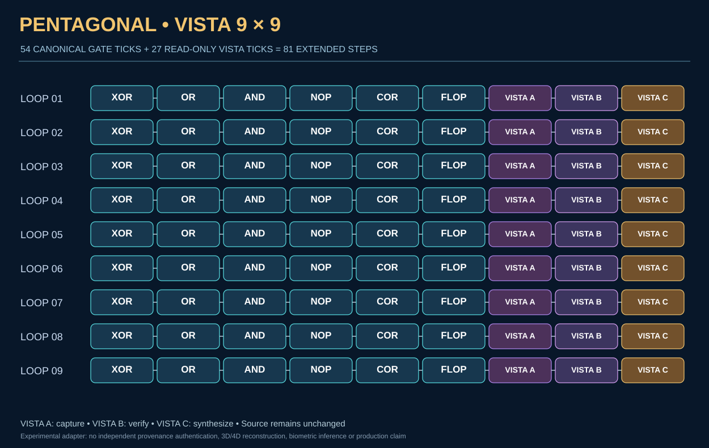

# VISTA 9×9 · three observational passes on the six-gate cascade

**Status:** EXPLORATORY independent adapter; **license:** 0BSD; **protocol:** `VISTA-9X9-v1`.
This is an opt-in extension, not a replacement for canonical
`shared/pentagonal_xor_std_free.h`, `shared/pentagonal_gates.hpp`, or
the original six-stage `Machine`.

\n\n## Why 9 × 9

The user asks for *nine complete cycles* and *three VISTA passes after the
existing six gates*. We define one **extended loop** as:

```text
[XOR][OR][AND][NOP][COR][FLOP][VISTA-A][VISTA-B][VISTA-C]
 × 9 complete loops = 81 scheduled steps
```

Each of the three VISTA passes reads **all six saved gate outcomes**.
Thus every gate is visible in each pass, without interpreting the phrase
"three after each gate" as eighteen extra scheduler ticks (which would
give 24 × 9 = 216, not 9 × 9).

| Item | Per extended loop | Nine loops |
|---|---:|---:|
| Canonical gate ticks | 6 | 54 |
| Separate VISTA read-only passes | 3 | 27 |
| Scheduled extended steps | 9 | **81** |
| Gate snapshots observed across VISTA passes | 3 × 6 | **162** |

FLOP completes the native six-stage loop and resets the next native
entry to XOR **without executing an extra XOR**. The surrounding
application performs the three VISTA reads before scheduling the next
native tick. No native gate stages were inserted or reordered.

## A → B → C: semantics

All three views use the same captured COR state, the same original
observed and expected input values, and the same caller-supplied
`source_token`. No source data are modified.

1. **VISTA-A / CAPTURE:** preserve six gate outputs, the 64-bit COR
   record, original observed/expected values and source handle.
2. **VISTA-B / VERIFY:** read the same trace and report whether gate
   order, XOR/OR/AND/NOP held values, 64-bit COR field packing, and
   FLOP next-entry agree with the existing source implementation.
3. **VISTA-C / SYNTHESIZE:** present the same retained trace and the
   structural agreement. This is a read-only summary, not a repair,
   correction, independent measurement or majority authorization.

The current C++ interface has three explicitly labeled snapshot types,
each with a `structurally_consistent` indicator and the six gate records.
No synthetic confidence, age, height, personal identity, depth or
biometric percentile is created from photographs.

`witness_reported` means *the caller claimed a witness was present*.
`independently_authenticated` is **false** for every local record:
an independently protected, validated witness is not implemented.
A correctly formed COR 64-bit record and a zero rupture mask cannot
establish forensic authenticity.

## Correct use with existing code

```cpp
#include <swe/pentagonal_vista_9x9.hpp>
#include <array>
using namespace swe::pentagonal::vista9x9;

std::array<Input, 9> nine_inputs{};
for (unsigned n=0; n<9; ++n) {
    nine_inputs[n].observed = 0x17;   // example 30-bit ligand observation
    nine_inputs[n].expected = 0x1f;   // separately supplied example reference
    nine_inputs[n].source_token = 100+n;
    nine_inputs[n].witness_present = false;
}
const Report record = execute(nine_inputs);
// 54 native gate ticks, 27 observational reads, 81 extended steps.
// 162 gate-view records; 9 full native loops; original array unchanged.
```

The `execute` function is deterministic and bounded. The 30-bit
input can encode six five-bit blocks; the ninth loop does not imply
nine independent measurements. Caller-provided photo-derived features
must be separately defined, recorded, calibrated and frozen before
feeding them to the Boolean controller.

Native demonstration (PowerShell 7 on Windows):

```powershell
cmake -S . -B build -DBUILD_TESTING=ON
cmake --build build --config Release
ctest --test-dir build -C Release --output-on-failure
.\build\Release\pentagonal_vista9x9.exe 0x17 0x1f
```

On single-configuration build systems the executable may be in
`build/` rather than `build/Release/`. The CLI prints all nine loops,
all six native outcomes, all three VISTA passes, 81 extended steps,
COR rupture masks and missing-witness status. It does not ingest images
or claim a real deployment.

## Reproducibility and negative tests

`tests/pentagonal_vista_9x9_test.cpp` checks all 32 five-bit states
across nine completed native loops, including the complete 54/27/81
count, 162 six-gate snapshot reads, original input preservation,
canonical gate order and no seventh XOR. It preserves and detects
mismatched COR blocks, replay flags, backward-clock flags, and
invalid-entry alerts. It refuses to label locally copied evidence
"independently authenticated."

## Demonstration custody and production boundary

[User-supplied demonstration inventory](VISTA_9X9_SHOWCASE.md)
indexes the accompanying DecaSigma, TriDi, Boxx-Hobb-Hall, eye-landmark,
and 4D-mesh imagery. Those images are **conceptual illustrations**
and may include explicitly estimated landmarks, stylization, and
unverified numbers. They are not an independently attested deployment,
clinical measurement, 3D reconstruction, or production acceptance test.
The supplied `DecaSigma_S3_4D_Mesh_Package(1).zip` explicitly describes
its 4th coordinate as *photo order*, not physical depth, and records
source provenance that is separate from this new 9×9 experiment.

**Authority and change control:** original source → measurement mapping →
six-gate controller → COR → triple VISTA → report → audit. A mismatch
remains evidence; no inferred image, renderer or ledger overwrites source.
A new protocol ID is required if the gate order or ligand definition
changes.
